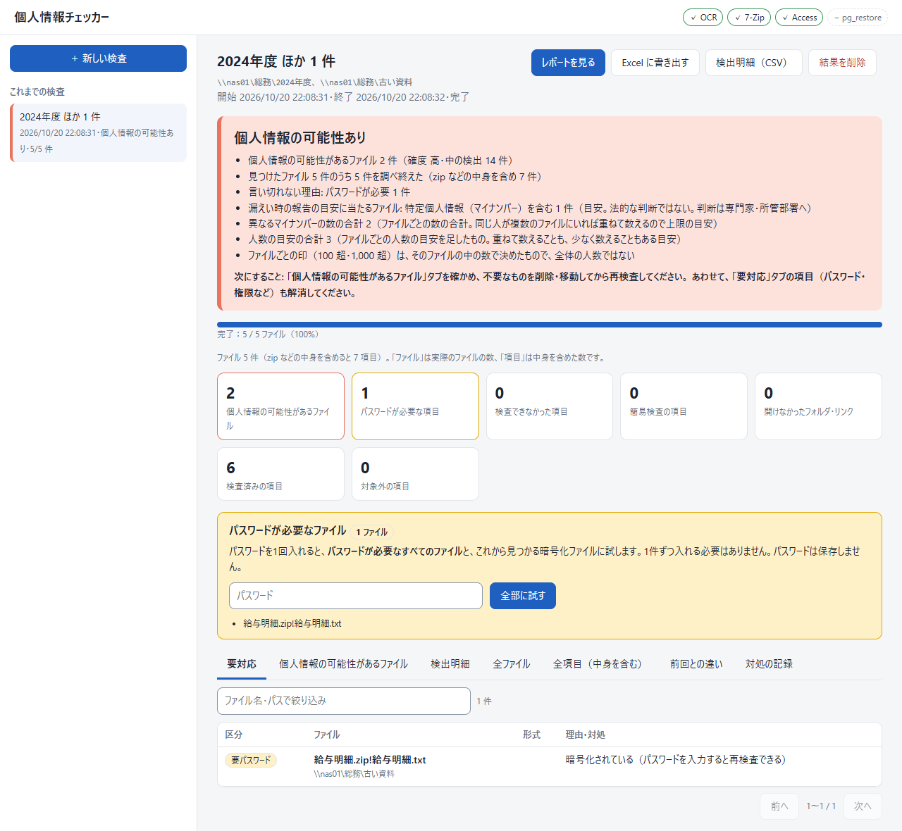

# 個人情報チェッカー（personal-info-checker）

**共有フォルダ（NAS）の中に、個人情報の入ったファイルが残っていないかを調べる Windows 用のツールです。**

フォルダを指定すると、その下にあるすべてのファイルを中身まで開いて調べ、マイナンバー・氏名・住所・電話番号・メールアドレス・口座番号などの個人情報と思われるものを一覧にします。結果は Excel・CSV のレポートにして渡せます。

**調べたファイルや見つけた個人情報を、外へ送ることはありません。** 検査先（NAS・FTP サーバー）を読むほかはどこにも接続せず、結果もこの PC の中にだけ保存します。



## 目次

- [すぐ使う](#すぐ使う)・[特長](#特長)・[向いている用途](#向いている用途)
- [準備と起動](#準備と起動)・[検査のしかた](#検査のしかた)・[結果の見かた](#結果の見かた)
- [何を個人情報とみなすか（判定の基準）](#何を個人情報とみなすか判定の基準)・[コマンドで使う](#コマンドで使う)・[困ったとき](#困ったとき)・[できないこと・注意](#できないこと注意)
- [対応している形式](#対応している形式)・[安全のための決まり](#安全のための決まり)・[Python で動かす](#python-で動かす)・[問い合わせ・開発者向け](#問い合わせ開発者向け)・[ライセンス](#ライセンス)

## すぐ使う

1. [Releases](https://github.com/AgemameSutachi/personal-info-checker/releases/latest) から `PiiChecker-<版>.zip` をダウンロードし、好きな場所に展開する（Python は要りません）
2. 展開した `PiiChecker` フォルダの `PiiChecker.exe` をダブルクリックする
3. 調べるフォルダを入れて「検査を始める」を押す

初めて起動するとき「Windows によって PC が保護されました」と出たら、「詳細情報」→「実行」を押します（署名の無いアプリのため）。展開する前に、zip を右クリック →「プロパティ」→「許可する」にチェックを入れておくと出ません。

ダウンロードした zip が本物か確かめたいときは、PowerShell で `Get-FileHash .\PiiChecker-<版>.zip` を実行し、出た値が Releases のページに載せた SHA256 と同じかを見ます（社内で配布の許可を取るときの材料にもなります）。

## 特長

- **調べ残しが無いかまで示す** … 読めなかったファイル（パスワード付き・破損・権限なし など）は理由つきで必ず一覧に残します。すべて読めて何も見つからなかったときだけ「検出なし（全ファイルを中身まで検査した）」と表示するので、「このフォルダに個人情報は無い」と断言してよいかが分かります
- **中身や埋め込みまで調べる** … Excel・Word・PowerPoint・PDF・Access・メール・画像（文字認識）・zip などの圧縮ファイル（入れ子も）・ディスクイメージ・git の履歴まで。拡張子を変えたファイルも中身で見分けます
- **パスワードは1回入れれば全部に試す** … 暗号化された zip や Office ファイルが複数あっても、パスワードを1回入れれば全部に試します
- **検査は何も書き込まない** … 検査はファイルを読むだけで、検査先には何も書き込みません。見つけた個人情報への対処（削除・置き換え）は、画面で選んで実行したときだけ書き換えます。**元の写しは作りません**（個人情報のファイルを手元のディスクへ写さないため）。書き換えたときも削除のときも、元のファイルはごみ箱へ送ります（ごみ箱が無い場所では、元は残りません）
- **保存・レポートには伏せた値だけ** … 結果の保存先と Excel／CSV には `***-****-5678` のように伏せた値だけを残します。画面では、ファイルの詳細を開いたときに元のファイルを読み直して検出した値そのものを出します（読み直した値は保存せず、「伏せて表示」にも切り替えられます）
- **NAS・FTP に直接つなげる** … フォルダの指定のほか、SMB（Windows 共有・Samba）・FTP・FTPS にユーザー名とパスワードで接続して調べられます

## 向いている用途

**場所を指定して、そこに個人情報が無いと言い切れるかを確かめる**道具です。たとえば次のようなときに使います。

- NAS の共有フォルダ・部署のフォルダに、名簿や履歴書が置きっぱなしになっていないかを点検する
- 引き継ぎ・外部への受け渡し・廃棄の前に、フォルダやディスクイメージの中身を確かめる
- 同じ場所をタスクスケジューラで定期的に検査し、前回から増えたものを見る

管理者が社内の各 PC に配って一斉に調べ、1か所の管理画面に結果を集めたり、見つけたファイルを暗号化・隔離したりする用途には向きません（それは端末管理の製品の領分です）。検査そのものは調べた先に何も書き込みません。見つけたものへの対処（削除・置き換え）は、画面で人が1ファイルずつ選んだときだけ行います（[検出した個人情報への対処](#検出した個人情報への対処)）。

## 準備と起動

配布版（「すぐ使う」の zip）は、展開した `PiiChecker` フォルダごと（約 190MB）を好きな場所へ置くだけで動きます。Python の入っていない PC でも使えます。使い方は3通りで、どれも同じ検査をします。

| 使い方 | 起動のしかた | 向いているとき |
| --- | --- | --- |
| アプリ版（デスクトップアプリ） | `PiiChecker.exe` をダブルクリック（調べたいフォルダを重ねて離すと、それを入れた状態で開く） | ふだんはこれ |
| Web 版（ブラウザ） | `cmd\PiiChecker-cmd.exe serve` | ブラウザで操作したいとき |
| コマンド版 | `cmd\PiiChecker-cmd.exe scan …` | 定期実行・無人実行（「コマンドで使う」の節） |

- コマンド版・Web 版の exe は、`PiiChecker` フォルダの中の `cmd` フォルダにあります（ダブルクリックではなく、コマンドで使います）。エクスプローラーで `PiiChecker` フォルダを開き、アドレス欄に `cmd` と打って Enter で出る窓から、上の表のとおり `cmd\PiiChecker-cmd.exe …` と打ちます
- アプリ版と Web 版は同じ画面です。WebView2 が無い PC では、アプリ版も同じ画面を既定のブラウザで開き、小さなメッセージの窓が出ます。**このメッセージの窓を閉じる（OK を押す）と検査が中断する**ので、検査が終わるまで閉じないでください
- **アプリ版は、検査中に窓を閉じると検査が中断します**（閉じる前に確認が出ます。あとで「再開」で続きから進められます）。Web 版はブラウザを閉じても検査は続き、コマンドの窓で Ctrl+C を押してサーバーを止めると中断します
- Web 版は起動すると合言葉入りの URL（`http://127.0.0.1:8765/?token=…`）を表示してブラウザを開きます。既定では自分の PC からしか開けません。IPv6 で待ち受けるときは `--host ::1` を付けます（URL は `http://[::1]:8765/?token=…`）
- 画像の文字は Windows 標準の OCR で読みます。日本語の「光学式文字認識」が入っていない PC では、画像が「検査不能」になります（画面の上にこの PC で使える機能が出ます）
- 結果は `%LOCALAPPDATA%\PiiChecker\jobs.sqlite3` に保存され、左の「これまでの検査」に並びます

ほかの PC から Web 版を使うときは、次のように起動します。

```
cmd\PiiChecker-cmd.exe serve --host 0.0.0.0 --token <推測されにくい長い合言葉>
```

- ブラウザは自動では開きません。ほかの PC で、表示された URL の `127.0.0.1` をこの PC の名前か IP アドレス（`ipconfig` で確かめる）に置き換えて開きます（ポートは 8765）
- 初回に Windows のファイアウォールの確認が出たら、社内ネットワークで「許可」を選びます。出ない・つながらないときは、管理者に TCP 8765 番を開けてもらいます
- 調べる場所と SMB の接続は、**serve を動かしている PC から見た場所とアカウント**になります

## 検査のしかた

左上の「＋ 新しい検査」を押し、場所を指定して「検査を始める」を押します。場所の指定は「フォルダを指定」と「接続方式を選ぶ」の2通りです。

### フォルダを指定する（ふだんはこちら）

1. 「検査する場所の指定方法」で「フォルダを指定」を選ぶ
2. 「検査するフォルダ」に、1行に1つずつ場所を入れる。NAS は `\\nas01\総務\2024年度` の形、手元は `D:\共有` の形。アプリ版は「フォルダを選ぶ…」でも選べる
3. 暗号化された zip・Office ファイルのパスワードが分かっていれば、1行に1つ入れる（空でもよい。後で聞かれる）
4. 「検査を始める」を押す


図: 新しい検査の画面（フォルダを指定）。検査するフォルダを1行に1つ入れて「検査を始める」を押す（Web 版の画面。アプリ版は「フォルダを選ぶ…」のボタンも付く）

場所は、エクスプローラーでフォルダを開き、上のアドレス欄をクリックして出る文字をコピーすると確実です。

### 接続方式を選ぶ（SMB・FTP・FTPS）

ドライブにつないでいない NAS や FTP サーバーを、ユーザー名とパスワードで直接調べるときに使います。

1. 「接続方式を選ぶ」を選ぶ
2. 「接続方式」を下の表から選ぶ
3. 「サーバー」（名前か IP アドレス）、SMB なら「共有名」、必要なら「フォルダ」を入れる。フォルダが空のとき、SMB は共有の全体、**FTP・FTPS はログインしたときの場所**（サーバー全体とは限らない）を調べる。FTP のフォルダは、ログインしたときの場所から見た場所で入れる（先頭の `/` は付けても無視される）
4. 「ユーザー名」と「パスワード」を入れる。ユーザー名が空なら、SMB は今の Windows のアカウント、FTP は匿名でつなぐ
5. FTP・FTPS は「ファイル名の文字コード」、FTPS は「サーバーの証明書を確かめる」を必要に応じて変える
6. 「接続を確かめる」で先につながるか試す。出てくる場所が、調べたい所と合っているかを確かめる（FTP・FTPS では、そのフォルダの直下に見えるファイルとフォルダの数も出る）
7. 「検査を始める」を押す


図: 接続方式を選んだ画面（SMB の例）。サーバー・共有名・フォルダ・ユーザー名・パスワードを入れ、「接続を確かめる」で先に試す

| 接続方式 | 既定のポート | 使うとき |
| --- | --- | --- |
| Windows 共有・Samba（SMB） | 変えられない | Windows サーバー・NAS の共有フォルダ |
| FTP（暗号化なし） | 21 | 社内の古い FTP サーバー。パスワードが平文で流れる |
| FTPS（明示的 TLS・AUTH TLS） | 21 | 暗号化できる FTP サーバー（ふつうはこちら） |
| FTPS（暗黙的 TLS） | 990 | 990 番で待ち受けるサーバー |

- 接続のパスワードは保存しません。アプリを開き直してから中断した検査を再開するときは、もう一度聞かれます（開いたままなら、サーバーにパスワードを断られたとき＝パスワードが変わった等を除いて聞かれません）。サーバーが止まっている・回線が切れているときは理由だけが出ます。パスワードは覚えたままなので、つながることを確かめてから、もう一度「再開」を押します
- SMB は Windows の接続でつなぎ（ドライブ文字は使いません）、`\\サーバー\共有` として調べます。エクスプローラー等で既に開ける共有は、その接続をそのまま使います。接続は、アプリ版・Web 版ではアプリを閉じるまで、コマンド版では検査の最後まで保ちます
- FTP は1件ずつ手元の一時フォルダへ写して調べ、調べ終えたら写しを消します
- 読み取り専用の共有（日時を書く権限が無いアカウント）では、ファイルの最終アクセス日時がサーバー側で更新されます。保ちたいときは、属性の書き込みを許した検査用のアカウントで接続します
- NAS の自己署名の証明書では「証明書を確かめる」を外したまま使います（その分、成りすましには気づけません）

### 詳しい設定（必要なときだけ）

| 設定 | 既定 | 変えるとき |
| --- | --- | --- |
| 画像とスキャンした PDF を OCR で読む | 入 | 外すと画像は「検査不能」になり、言い切れなくなる |
| 前回から変わっていないファイルは前回の結果を使う | 入 | 書き換えが疑わしいときは外して全部読み直す |
| ディスクイメージの空き領域も調べる | 切 | 削除されたファイルまで調べたいとき（時間がかかる） |
| 同時に調べるファイルの数 | 自動 | NAS や PC が重いときに減らす |
| 1ファイルの時間制限 | 30 分 | 大きなファイルは大きさに合わせて自動で延びる（1秒あたり 512KB を最低の読む速さとみなす。3GB なら約100分）。それでも時間切れになるときに延ばす。打ち切られても、途中までに見つけた分は記録される |
| 展開に使う一時フォルダ | Windows の一時フォルダ | 大きなディスクイメージを調べるときは空きの多いドライブへ |
| 拾わない値（許可リスト） | 空 | 自社の代表番号・所在地・書類の見本の名前などが、毎回「要確認」に並ぶとき |
| 自分で足す規則 | 空 | 社員番号・顧客番号など会社ごとの形の番号や、「機密」などの語も探したいとき |

### 拾わない値・自分で足す規則

- **拾わない値**は1行に1つ書きます。見つけた値がまるごと同じときだけ外します（一部だけ同じものは外しません）。全角と半角・空白・ハイフン・括弧の違いは無視し、氏名は「様」などの敬称を外して比べます。外した件数は総合判定とレポートに「拾わない値（許可リスト）で外した検出 N 件」と出ます（黙って消しません）。外したために検出が無くなったときは、判定に「拾わない値（許可リスト）の値を除いて」と添えます。値そのものはレポートに載せません
- **自分で足す規則**は1行に1つ、`名前 | 探す語か正規表現 | 確度` の形で書きます（確度は 高・中・低。省けば 中）。例: `社員番号 | EMP-\d{6} | 中`・`顧客番号 | C\d{8}`・`機密`。見つかったものは種類「利用者の規則」として、規則の名前つきで明細に出ます（画面では「利用者の規則（社員番号）」、Excel・CSV では「検出規則」の列）。「個人情報の可能性があるファイル」の検出の内訳と、詳細・Excel の「異なる値」も規則の名前ごとに出します（「利用者の規則（社員番号） 1」）。`#` で始まる行は読み飛ばします。「または」は `(?:EMP|STF)-\d{6}` のように括弧で囲みます
- 正規表現は複数行モードで当てます（`^`・`$` は行の頭・終わりに当たる。`^C\d{3}` は各行の頭の「C123」を拾う）。Excel のセル内改行やメールの本文の改行（CR LF・CR）も、行の境目として扱います。全角の英数字は半角として扱い（`ＥＭＰ` は `EMP`）、全角の記号（`＊`・`（）` など）は正規表現の記号にせず、その文字そのものとして探します（`株式会社（本社）` は括弧ごと探す）
- 書き方の誤りは、検査を始める前に何行目が悪いかを示して断ります。検査が極端に遅くなる書き方（`(\d+)+`・後方参照・`.*.*x` や `[a-z]{1,200}[a-z]{1,200}!` のように同じ文字に当たる長い繰り返しを続けた形・`(?:a|b|ab)*c` のように繰り返しの中の選択肢が同じ文字で始まる形など）も断ります。回数の上限が 16 を超える繰り返し（`{1,200}` など）は、上限の無い繰り返しと同じに扱います。正規表現は 200 文字までです
- この2つの欄は、次の検査にも前回の値を入れておきます。**入れた値は、次回の既定と再開のため、この PC の結果の保存先（`%LOCALAPPDATA%\PiiChecker\jobs.sqlite3`）にそのまま残ります**（レポートには件数と規則の名前だけが出て、値は出ません）。どちらかを変えた検査では、前回の結果を使い回しません

## 結果の見かた

検査の画面の一番上に総合判定が出ます。「検出なし（全ファイルを中身まで検査した）」が出れば、その場所に個人情報は無いと言い切れます。「要確認」のときも、候補を目で見て個人情報でなければ言い切れます。

見つけたものには **確度**（個人情報である見込みの強さ。高・中・低）が付きます。たとえば「マイナンバー 123456789018」は高、語の付かない12桁の数字は低です。基準は「何を個人情報とみなすか（判定の基準）」の節にあります。


図: 検査が終わった画面。一番上が総合判定、その下に件数の枠、パスワードが必要なファイルの欄、結果の表のタブが並ぶ

### 総合判定（上から順に当てはまるものが出る）

| 判定 | 意味 | すること |
| --- | --- | --- |
| 検査中 | まだ調べている | 終わるのを待つ（判定は途中の値） |
| 個人情報の可能性あり | 確度 高・中の検出がある | 「個人情報の可能性があるファイル」を開いて中身を確かめる |
| 言い切れない（検査を途中で止めた） | 1件も数えないうちに止まった | 止めた理由（NAS への接続など）を直してから「再開」 |
| ファイルが見つからない（言い切れない） | 1件も無かった | 場所の指定違い・権限で見えていないことを疑う |
| 言い切れない（調べられなかったものがある） | 調べられなかったものがある（理由の件数つき） | 「要対応」を開き、パスワードを入れる・権限を直すなど。理由が「まだ調べていない」なら、原因を直して「再開」 |
| 要確認（確度の低い候補のみ） | 確度の低い候補だけ | 「検出明細」で本当に個人情報か目で見る |
| 検出なし（一部は簡易検査） | 構造を読めず文字だけ見たものがある | 「要対応」タブで簡易検査のファイルを確かめる |
| 検出なし（全ファイルを中身まで検査した） | 言い切れる | なし |

### ファイルごとの状態

すべてのファイル（zip の中身・埋め込み・添付も）に次のどれかが付きます。黙って飛ばすものはありません。

| 状態 | 意味 |
| --- | --- |
| 検査済み | 中身を構造ごと読んだ |
| 簡易検査 | 構造を解釈できず、文字として読める部分だけ見た（PST・読み解けない形の Oracle ダンプなど） |
| 要パスワード | パスワード候補を全部試しても開けない |
| 検査不能 | 破損・未対応・時間切れ・権限なし・OCR 不可など（理由と対処が出る） |
| 対象外 | 動画・音声・実行ファイル・フォント・分割アーカイブの2つ目以降 |

### パスワードが必要なファイル

暗号化されたファイルがあると「パスワードが必要なファイル」の欄が出ます。パスワードを入れて「全部に試す」を押すと、パスワードが必要なすべてのファイルと、これから見つかる暗号化ファイルに試します。1件ずつ入れる必要はありません。


図: パスワードが必要なファイルの欄。パスワードを入れて「全部に試す」を押す

開けると欄が「パスワードの結果」に変わり、中身も検査されて判定と件数が更新されます（この例では zip の中の給与明細からも検出が出て、個人情報の可能性があるファイルが 2 件から 3 件に増えた）。


図: パスワードで開けた後の画面。「1 件すべて開けました」と出て、要パスワードが 0 件になる

接続方式（ユーザー名あり）で調べた検査を、アプリを閉じて開き直してから見ているときは、「ファイル（zip 等）のパスワード」と並んで「（接続先）のパスワード（ユーザー名）」の欄も出ます。ファイルを読み直すためにサーバーへつなぎ直すので、両方を入れてから「全部に試す」を押します（どちらも保存しません）。

### 結果の表（7つのタブ）

| タブ | 中身 |
| --- | --- |
| 要対応 | 言い切りを妨げているもの（要パスワード・検査不能・まだ調べていないもの・開けなかったフォルダ・辿らなかったリンク）と、簡易検査のもの |
| 個人情報の可能性があるファイル | 検出のあったファイルの一覧（報告の目安・誰が読めるかの列つき。大きさ・更新日時は行を押した詳細に出る） |
| 検出明細 | 検出1件ずつ（種類・確度・値と前後の文脈・場所。はじめは伏せた値で、行ごとの「値を表示」でそのファイルを読み直して検出した値を出す） |
| 全ファイル | 列挙したすべてのファイルと状態 |
| 全項目（中身を含む） | zip の中身・埋め込み・添付まで含めたすべて |
| 前回との違い | 同じ場所の前回の検査と比べて、新しく見つかった・無くなった・件数が増えた／減ったファイル |
| 対処の記録 | 画面から実行した対処（削除・置き換え）の記録。元のファイルをごみ箱へ送ったか・残らなかったか、途中で止まったものを立て直したかも出る。値は書かない |

- 判定の下に並ぶ件数の枠を押すと、その内容のタブへ飛びます
- 表の上の欄でファイル名・パスで絞り込めます。「検出明細」タブでは種類・確度でも絞り込めます
- 検出明細は、1つの項目（ファイル・zip の中の1ファイル等）・1種類・1確度あたり20件まで載せ、同じ値は1件にまとめます（件数は全部数えます）。後から人の手がかりが見つかって 中 に数え直した住所・電話は、中 の明細が埋まっていると 低 の欄に残り、「件数は 中 に数えた」と添えてあります
- 行を押すと詳しい内容が開きます。「パスをコピー」、アプリ版では「エクスプローラーで場所を開く」も使えます


図: 検出明細のタブ。検出1件ずつ、ファイル・種類・確度・値・場所（シートとセル、行）・前後の文脈が並ぶ（図は伏せた値の表示）


図: 行を押して開いた詳細。そのファイルの読み方と、見つかった個人情報の一覧が出る（開くと元のファイルを読み直して検出した値を出す。図は伏せた値の表示。「伏せて表示」で伏せた値に切り替えられる）（同じ値は1件にまとめて表示する。上の「検出: 氏名 4…」の件数は、まとめる前の数をすべて数えたもの）

### レポートの書き出し

- 「レポートを見る」: 結果をまとめたページ。「印刷・PDF に保存」で PDF にできる
- 「Excel に書き出す」: レポートと同じ中身の .xlsx（`個人情報チェッカー_<ジョブID>.xlsx`）。アプリ版は保存先を聞き、保存後に自動で開く。Web 版はブラウザのダウンロード（ブラウザを開いている PC 側）に保存される
- 「検出明細（CSV）」: 検出1件ずつの CSV


図: 「レポートを見る」で開くページ。判定と概要（列挙したファイル数と結果のあるファイル数の一致など）が並ぶ

Excel のシートと画面の対応は次のとおりです。

| シート | 中身 | 画面では |
| --- | --- | --- |
| 判定 | 総合判定・件数・次にすること | 一番上の判定 |
| 要対応 | 言い切りを妨げているもの | 「要対応」タブ |
| ファイル別 | ファイルごとの状態・危険度・検出件数・報告の目安・異なる値の数・誰が読めるか | 「全ファイル」タブ（検出のあるものは「個人情報の可能性があるファイル」） |
| 前回との違い | 前回の検査と比べた違い | 「前回との違い」タブ |
| 検出明細 | 検出1件ずつ | 「検出明細」タブ |
| 全項目 | 中身・埋め込み・添付まで含めたすべて | 「全項目（中身を含む）」タブ |

レポートには「列挙したファイル数」と「結果のあるファイル数」の一致も載ります（取りこぼしが無い証拠）。検査中は「中止」、止まった検査は「再開」で続きから進められます。不要になった結果は「結果を削除」で消せます（検査先のファイルは消えません。検査中は消せないので、先に「中止」します）。

### 報告の目安・誰が読めるか・前回との違い

- **報告の目安**: ファイルごとに「特定個人情報（マイナンバー）を含む」「要配慮個人情報を含む」「財産的被害のおそれ（カード番号・口座番号）」（表の札は「被害のおそれ（カード・口座）」）「異なるマイナンバーが 100 を超える」「人数の目安が 1,000 を超える」の印が付きます。100 超・1,000 超の印は、**そのファイルの中の数**で決めたもので、全体の人数ではありません。そのため総合判定（画面・Excel の判定シート・コマンドの最後）には、ジョブ全体の「異なるマイナンバーの数の合計」と「人数の目安の合計」も出し、100・1,000 を超えたら目安として示します。マイナンバーの合計はファイルごとの数を足したもので、同じ番号が複数のファイルにあれば重ねて数えるので上限の目安です。人数の目安の合計は、ファイルごとの人数の目安（下の「異なる値の数」）を足したもので、重ねて数えることも、少なく数えること（あるファイルは氏名、別のファイルはメールで数えた等）もある目安です。漏えいしたときに個人情報保護委員会への報告が要るかの**目安で、法的な判断ではありません**（暗号化などの措置の有無や、実際に漏えいしたかは、このツールには分かりません）。判断は専門家・所管部署へ。根拠は個人情報の保護に関する法律施行規則 第7条（要配慮・財産的被害・本人の数が千人を超える等）と、特定個人情報の漏えい等に関する報告等に関する規則 第2条（本人の数が百人を超える等）です
- **異なる値の数**: 同じ値（全角半角・空白・ハイフン・氏名の敬称の違いは無視）を1つと数えた数です（確度 中以上）。値そのものは保存しません。人の数は分からないので、氏名・マイナンバー・メール・電話などのうち異なる値が最も多い種類の数（人数の目安）で代え、どの種類で判断したかを示します。数が同じ種類が並んだときは、氏名＞マイナンバー＞メール＞電話＞住所＞…の順で選びます。利用者の規則は規則の名前ごとに数えます（人数の目安には使いません）
- **誰が読めるか**: 検出のあったファイルの親フォルダのアクセス権を読み、Everyone・Authenticated Users・Users・Domain Users などに読み取りが許されていれば「広く読める」、その許可が見当たらなければ「広い許可なし（目安）」（札は灰色。安全という意味ではないため緑にしない）、読めなければ「読めなかった」と出します（FTP は「取れない」）。「広い許可なし」は**限られた人だけとは言い切れません**: 全社員を入れたグループ（会社が作ったグループ）・Samba の Unix のグループ・ファイル個別のアクセス権・グループの入れ子・共有のアクセス許可は見ていません。サブフォルダにだけ継承される設定は、そのフォルダのファイルには届かないので数えません。読むだけで何も変えません。危険度は変えません。フォルダの所有者は、よく知られたアカウント（SYSTEM・Administrators など）とこの PC のアカウントだけ名前で出し、ドメインのアカウントなどは `S-1-5-21-…` の形のまま出します（名前を引くとドメインコントローラーへ問い合わせが飛ぶため。検査先を読むほかはどこにも接続しない約束を守る）
- **前回との違い**: 同じ場所（同じフォルダの組、または同じ方式・サーバー・ポート・共有・フォルダ）を最後まで終えた前回の検査と比べ、新しく見つかった・無くなった・件数が増えた／減ったファイルを出します。定期の点検で、毎回全部を見直さなくて済みます
  - 「無くなった」には理由が付きます: 検出が無くなった（直した・中身が変わった）／今回は見つからない（消した・移した・名前を変えた、または今回は見えなかった）／今回は調べられなかった（要パスワード・検査不能・まだ調べていない・**今回開けなかったフォルダや辿らなかったリンクの下**）。調べられなかったものは、画面の札・Excel の色を要対応と同じにし、「無くなった（調べられなかった）」と出します（直ったとは言えないため）。今回は見つからないものは「無くなった（今回は見つからない）」として札・Excel の色を灰色にします。緑にするのは、検出が無くなった（直した）ものだけです
  - 大小文字だけ違うパス（`名簿.XLSX` と `名簿.xlsx`）は同じファイルとみなします（FTP を除く）
  - 前回と、拾わない値・自分で足す規則・OCR などの結果に効く設定や、検査器の版が違うときも比べますが、要約と「前回との違い」タブの表の上に「前回と設定（または検査器の版）が違うため、違いにはファイルの変化でないものを含みます」（違いが0件なら「ファイルの変化が隠れていることもあります」）と、何が違うかを添えます
  - 前回の検査は、日時（「前回の検査（2026-10-18 09:00 に終了）」）で示します

### 検出した個人情報への対処

見つけた個人情報を、画面から消したり置き換えたりできます。**検査そのものは何も書き込みません。自動では何も変わらず、人が方法を選んで実行したときだけ**そのファイルを書き換えます。検出のあるファイルの詳細（行を押すと開く）の「対処する…」から始めます。

1. 方法・対象にする種類と確度（シートも）・ダミーの作り方を選ぶ。選ぶ前に、そのファイルを読み直して**検出した位置を全部**集めます（明細の20件だけではありません）
2. 「下見」: 変わる行・列・シートの数と、変わる行の番号の例、注意（数式の参照がずれる等）を見る。ここではまだ何も変わりません
3. 「実行…」を押すと、対象のファイル名と内容をもう一度示すので、「実行する」を押す
4. 結果: 変わった数・残った検出（書き換えたファイルを検査し直した数）・元のファイルの行き先（ごみ箱へ送った／完全に削除した／入れ替えて残らない）が出ます

書き換えの実行の中身は次の順です。**途中で落ちても（アプリの強制終了・電源断）、元の中身か新しい中身のどちらかが、必ず元の名前（か「対処前」の名前）で残ります**。

1. 新しい中身を、元と同じフォルダの一時の名前（`~piichk-new-<英字>-元の名前`）に書き、ディスクへ確実に書き出す（flush・fsync）
2. 新しいファイルを検査し直して、開けることと残った検出の数を確かめる（ここまで元のファイルには触りません。失敗したら一時の新ファイルを消して終わり）
3. 対処の記録に「始めた」状態と段取り（元・一時の新ファイル・改名後の元の名前）を書く（**検出した値は書きません**）。一時の新ファイルを書き始める前に記録を作るので、書いている途中で落ちても片付けの手がかりが残ります
4. ごみ箱のある場所: 元を同じフォルダの中で「元の名前（対処前 YYYYMMDD-HHMMSS）.拡張子」に改名 → 一時の新ファイルを元の名前へ改名 → 改名した元をごみ箱へ送る。各段のあとで記録の状態を進めます。途中で普通に失敗したら、その場で元の状態へ戻します
5. ごみ箱の無い場所（ネットワーク・外付けなど）: `os.replace` で一時の新ファイルを元の名前へ入れ替える（入れ替えは1回で起きるので、元か新のどちらかが必ず残ります）。元のファイルは残りません（下見に「元のファイルは残りません（この場所にはごみ箱がありません）」と出ます）

途中で止まった記録は、アプリの起動時と、同じファイルに次の対処を始める前に立て直します（元の名前のファイルが無く「対処前」の名前のファイルがあれば元の名前へ戻す・一時の新ファイルが残っていれば消す・新しいファイルが入っていて改名した元が残っていればごみ箱へ送り直す。どれも判断できないときは、どちらのファイルも消さずに残します）。立て直した内容は「対処の記録」に出ます。

| 形式 | ファイルを削除 | 該当行を削除 | 該当列を削除 | ダミー化 | シート・表を削除 |
| --- | --- | --- | --- | --- | --- |
| csv・tsv・txt | ○ | ○ | ○（csv・tsv だけ） | ○ | － |
| xlsx・xlsm | ○ | ○ | ○ | ○ | ○（シート） |
| SQLite（.sqlite・.sqlite3・.db など） | ○ | ○ | ○ | ○ | ○（表） |
| SQL のダンプ（pg_dump の平文・mysqldump・INSERT 文の .sql など） | ○ | ○ | ○ | ○ | ○（表） |
| Access（.accdb・.mdb） | ○ | － | － | － | － |
| Oracle のダンプ（旧 exp） | ○ | ○ | ○ | ○ | ○（表） |
| Oracle のダンプ（expdp） | ○ | ○ | － | ○ | － |
| pg_dump のカスタム形式（-Fc）・ディレクトリ形式 | ○ | － | － | － | － |
| PDF | ○ | － | － | 黒塗り（文字ごと消す） | ○（ページを削除） |
| Word（docx・docm） | ○ | ○（表の行） | ○（表の列） | ○（＋該当の段落を削除） | － |
| PowerPoint（pptx・pptm） | ○ | － | － | ○ | ○（スライドを削除。ノートも） |
| xls・doc・ppt（旧形式）・その他 | ○ | － | － | － | － |
| 書庫そのもの（zip・7z・tar・gz・rar など） | ○（書庫ごと） | －（中のファイルを選ぶ。下の表） | － | － | － |

- **ファイルを削除**: **元の写しは作りません**（個人情報のファイルを手元のディスクへ写さないため）。ごみ箱のある場所（Windows のごみ箱）では、ごみ箱へ送ります。下見の1行目は「ファイル「X」をごみ箱へ送ります（ごみ箱から戻せます）」で、戻すにはエクスプローラーのごみ箱から戻します。ネットワーク・外付けなど**ごみ箱の無い場所**では、ごみ箱を経由せずにそのまま消します。下見の1行目は「ファイル「X」を完全に削除します（この場所にはごみ箱がありません。元に戻せません）」で、警告にも同じ旨が出ます。結果の表示と「対処の記録」（表の「元のファイル」の列）には、ごみ箱へ送ったか完全に削除したかが出ます。書庫ごとの削除・「zip に作り直す」で元の書庫を消すときも同じ扱いです
- **該当行・列の削除**: 行は、選んだ種類・確度の検出を含む行。列は、検出を含む列（csv・tsv だけ。txt に列は無い）。xlsx の行・列の削除は保存し直すため、数式の参照（別の行・列を指す式）・条件付き書式・入力規則・名前の定義は行・列の位置に合わせて直しません。図形・一部のグラフ・マクロの画面部品などが失われることがあります（下見に出ます）
- **ダミー化**: 検出した値の部分だけを置き換えます。作り方は3つ: ①同じ値は同じダミー（種類の名前と8桁の符号。実行ごとのランダムな鍵で作り、鍵は保存しない。表の中の突き合わせが壊れない）②形を保つ（数字は 0、文字は 〇、区切りの記号は残す。`090-1234-5678` は `000-0000-0000`）③固定の「＊＊＊」。xlsx のダミー化は zip の中の XML のうち対象のセルだけを書き換えるので、書式・グラフ・ピボット・図形・マクロは壊れません（セルは文字列になり、数式のセルは書き換えません。置き換えて使われなくなった共有文字列も空にして、元の値が部品の中に残らないようにします）
- csv・tsv・txt は、文字コード・BOM・改行・区切り・引用符の付け方を元のまま保ち、触らない行は元の文字列のまま写します
- **「元に戻す」ボタンはありません**（元の写しが無いため）。ごみ箱へ送ったときは、結果と記録に「エクスプローラーのごみ箱から「元の名前（対処前 …）」を戻してください」と出ます（この名前で戻ります。このアプリがごみ箱から自動で戻すことはしません）。ごみ箱の無い場所で消した・入れ替えたときは、戻せません
- **下見の注意は2種類**: 赤い太字の注意（`warnings`＝消える・戻せない・壊れうるもの）を先頭に、仕組み・保たれるもの（`notes`）は「詳しい説明」の折りたたみに出します。元のファイルの行き先は帯で示します（ごみ箱へ送る＝青、完全に削除・元が残らない＝赤）。対処のあと、そのファイルの検出明細は「対処前の結果」の帯つきで伏せた値に戻り、再検査で最新になります
- 残った検出の数では、**この回で作ったダミーそのもの**は数えません（列見出しが「メール」「氏名」の列は、中身が何であれ値として拾う規則があるため、ダミーまで検出に数えてしまうので）

選べない・できないもの:

- 読み取り専用のファイル・FTP の先のファイル・パスワード付き（暗号化）のファイル（検査のとき入れたパスワードがある PDF は、同じパスワードで暗号化し直して書き換えられます）・中身を最後まで構造どおりに読めなかった（簡易検査・検査不能の）ファイル・対応していない形式は、中身の書き換えを選べません（理由が画面に出ます）。書庫の中のファイルは、下の「書庫の中のファイルへの対処」
- 位置の数が 200 万件を超えるファイル、256MB を超える csv・tsv・txt は中身を書き換えません（ファイルの削除はできます）。SQL のダンプは、UTF-16 だけ 256MB まで（ほかの文字コードは巨大でも書き換えます）
- 位置を持たない検出（内側のファイル・ファイル名・画像の中の文字など）は、この対処では変わりません。実行のあとの検査し直しで「残り」として出ます
- 行・列の位置が検査と食い違う可能性があるため、UTF-8・Shift_JIS（cp932）・EUC-JP・UTF-16 以外の文字コード、元のバイト列に正確に戻せない文字コードの csv・txt は書き換えません
- この検査の結果（検出の一覧）は、対処しても対処の前のままです。反映するには検査し直します（結果の DB の検出は書き換えません）
- 書き換えたファイルのアクセス権（ACL）・代替データストリームは、新しいファイルへ引き継ぎません（同じフォルダの既定の権限になります。元のファイルはごみ箱の中のものが持っています）
- ごみ箱へ送るときの注意: ごみ箱の容量より大きいファイルは、ごみ箱に入らず完全に削除になります。そのときだけ Windows の確かめの窓が出ます。「いいえ」を選ぶと対処を取りやめ、元のファイルのまま残ります

#### データベースへの対処（SQLite・SQL のダンプ・Oracle のダンプ・Access）

方法は、上の表のとおりです。「該当する表を削除」は、データベースの形式だけに出ます（検出した行だけでなく、その表のデータがすべて消えます）。対象にする種類・確度に加えて、「対象にする表」も選べます。

- **SQLite**（検査が SQLite と判定したファイル。拡張子は問いません）: **元のファイルは開いて書き換えません**。元の写しを一時の名前で作り、その写しに SQL を当てます（該当行は `DELETE`、該当列は `ALTER TABLE … DROP COLUMN`（SQLite 3.35 以上）、ダミー化は検出した値の入った欄だけの `UPDATE`、表は `DROP TABLE`）。終わりに `VACUUM`（空き領域も詰める）をかけ、`secure_delete` も使うので、消した値がファイルの空きに残りません（ファイルは小さくなることがあります）。そのあと検査し直して `integrity_check` が ok と確かめ、上の確定の手順で元の名前へ置きます
  - 行は検査の位置の rowid で特定します。WITHOUT ROWID の表などは、検査と同じ行の並び（通し番号）で数え直し、その行の主キーをその場で読んで特定します（位置に生の値は入れません。主キーが個人情報そのもの（メールアドレスなど）でも同じです）
  - 外部キーの連鎖削除は動かしません。その表のトリガーは、書き換えの間だけ外し、終わりに元の定義で作り直します（削除・更新のトリガーが、消した値をほかの表へ写してしまわないように）
  - 主キー・索引・外部キー・CHECK 制約・ビュー・トリガーに使われている列は、SQLite が削除を断ることがあります（下見に注意が出ます。断られたら何も変わりません）。主キー・一意の索引・外部キーの列のダミー化は、突き合わせが壊れたり、一意の制約で失敗したりすることがあります（失敗したら何も変わりません）
  - 元のファイルのそばに `-wal`・`-shm`・`-journal` の付属ファイルがあるときは、他のプログラムが開いている可能性があるので断ります（ファイルの削除はできます）。WAL モードの SQLite は、書き換えたあとも WAL モードのままです
  - 仮想表（FTS など）とその内部の表・`sqlite_` で始まる管理用の表は書き換えません（そこにある検出は「残り」として出ます）
- **SQL のダンプ**（pg_dump の平文・mysqldump・一般の INSERT 文の `.sql`。巨大でも）: 検査と同じ読み方で**1行ずつ読みながら**新しいファイルへ書くので、巨大でもメモリに載せません（複数行にまたがる INSERT 文だけは、「;」で終わる行まで1文として持ちます）。触らない行は元のバイト列のまま写し、文字コード（UTF-8・BOM つき・Shift_JIS（cp932）・EUC-JP・UTF-16）・改行を保ちます
  - 該当行の削除: COPY のデータ行と、INSERT 文の VALUES の1組（1行）。組がすべて無くなった INSERT 文は文ごと消えます
  - 該当列の削除: COPY の列と各行の欄・INSERT の列名と各組の値・CREATE TABLE の列の定義。その列を使う索引・制約の文（`CREATE INDEX`・`ALTER TABLE … ADD CONSTRAINT`・列のコメント）、CREATE TABLE の中でその列を使う `KEY`・`CONSTRAINT` の行も取り除きます。ほかの表の外部キーがその列を参照している場合は、読み込み時に失敗します
  - ダミー化: 値だけを置き換えます。INSERT の値は、元の引用符・エスケープの流儀（`''`・`\'`）・接頭辞（`N'…'`・`_utf8mb4'…'`）・前後の空白を保って書き直し、数値だった値は文字列として引用符で囲みます。COPY の欄は `\t`・`\n`・`\\` を正しくエスケープし、`\N`（NULL）は触りません
  - 表の削除: CREATE TABLE・COPY のブロック・INSERT 文・DROP TABLE・LOCK TABLES・DISABLE/ENABLE KEYS・その表の索引・制約・権限・コメント・トリガーの文を取り除きます（ほかの表の外部キーがその表を参照している場合は、読み込み時に失敗します）
  - 読み解けない INSERT 文（`NOW()` のような関数呼び出しの括弧が組の中にあるなど）を書き換える必要があるときは、壊さずに断ります。CREATE TABLE の列の定義が「1行に1列」の形でないとき（CREATE や閉じ括弧と同じ行に定義があるなど）は、列を削除できません
  - pg_dump のカスタム形式（-Fc）・ディレクトリ形式（toc.dat と `NNNN.dat`）は、ファイルの削除だけです
- **Access（.accdb・.mdb）**: 書き換えの手段（ODBC ドライバ・Access 本体）が環境によって違うため、いまはファイルの削除だけです（理由が画面に出ます）
- **Oracle のダンプ（旧 exp・expdp）**: 検査と同じ読み方で、表の区画ごとに読みながら新しいファイルへ書くので、数 GB でもメモリに載せません。触らない区画・表はバイト単位でそのまま写します。**書き換えたダンプは、そのまま使わずに、テスト用のデータベースへ imp（旧 exp）・impdp（expdp）で読み込んで確かめてから、元の場所へ戻してください**（このアプリは Oracle へ読み込んで確かめることはしません。下見にも出ます）。圧縮・暗号化したダンプ、表として最後まで読み解けなかったダンプ、想定と作りの違う区画は、壊さずに断ります（ファイルの削除だけ）
  - **旧 exp**（4 つの方法）: 該当行の削除（その行のバイト列を写さない）・ダミー化（文字は同じ文字セットで書き直す。NUMBER は 0 か同じ桁数の数・DATE は 1900 年代の日付を、Oracle の内部形式で正しい値として作る。列の長さに収まらないダミーは、同じバイト数の（鍵つきの）16 進の文字列に代える。CHAR は元の長さまで空白で埋める）・該当列の削除（CREATE TABLE の列・INSERT の列名と :n・列の定義・各行のその列。その列を使う索引・制約・列のコメントの文も取り除き、ほかの文がその列を使っていれば断る）・表の削除（定義・データ・統計・2 周目の ANALYZE の文の区画。ほかの表の外部キーがその表を参照している場合は、読み込み時に失敗します）。書き換えた表の統計（ANALSTATS。列の最小値・最大値に元の値が入っています）は取り除きます（読み込みのあとに取り直せます）
  - **expdp**（行の削除とダミー化だけ）: 列の定義（DDL）が圧縮された管理情報の区画に入っていて書き換えられないため、列の削除・表の削除は選べません。行の削除・ダミー化は、**ファイルの大きさを変えずに**（マスターテーブルが持つ各表の位置を保つため）行と索引を詰め、ブロックの見出し（制御ブロック）の値を直し、残りをゼロで埋めます。置き換える値は元より長くしません。**圧縮された管理情報の区画（列の統計の最小値・最大値など）は書き換えられず、そこに元の値が残っていることがあります**。完全に消したいときは、EXCLUDE=STATISTICS を付けて取り直したダンプを使ってください。Data Pump の管理用の表（マスターテーブル）は書き換えません
  - 同じ名前の区画（パーティション・複数のスキーマ）は、2 つ目から「名前 (2)」として別の表に数えます

#### PDF・Word・PowerPoint への対処

方法は、上の表のとおりです。位置は、PDF はページと行・文字の範囲、docx は部品（本文・ヘッダー・フッター・脚注・コメント）と段落・文字の範囲、pptx はスライド（とノート）と段落・文字の範囲で、検査のときに集めます（値そのものは持たず、書き換えるときにその場で読み直します）。

- **PDF の黒塗り**: 見た目だけを隠す注釈ではなく、ページの内容から**文字そのものを取り除き**（PyMuPDF の redact）、その場所を黒く塗ります。コピーしても、文字の抽出をしても、値は出てきません。**元に戻せません**。画像の中の文字を OCR で読んだ検出は、画像のその部分の画素を黒く塗りつぶします（OCR の文字の位置は近似なので、少し広めに塗ります）。塗ったあとで、値がページの文字から減ったことを確かめ、減っていなければ何も確定しません
  - 黒塗りのあと、**文書情報（作成者・題など）・XMP・注釈・フォーム欄・しおり・リンク・埋め込みファイル**に、消した値や選んだ種類・確度の検出が残っていれば、それも取り除きます（しおりの題は「－」になります）。ページの縮小画像（/Thumb。変える前のページが写っている）も外します
  - 保存は増分保存にしません（消した文字が古い版としてファイルに残らないよう、全体を書き直して使われなくなった部品も捨てます）。ファイルの内部の作りは変わります
  - パスワードで暗号化された PDF は、検査のとき入れたパスワードで開き、**同じパスワードで暗号化し直して**保存します（パスワードが手元に無いときは断ります。暗号化の方式は元に合わせます。所有者のパスワードも同じ値になります）
  - 「ページを削除」は、検出のあるページを丸ごと取り除きます（すべてのページは削除できません）
  - 回転したページ・全角の数字の値も扱えます。文字の層の作りが特殊で黒塗りで文字が消えない PDF は、何も変えずに断ります
- **Word（docx・docm）**: zip の中の XML を直接書き換え、画像・スタイル・埋め込みなどほかの部品は圧縮したままのデータをバイト単位でそのまま写します
  - ダミー化: 検出した値の部分だけを置き換えます。値が複数の文字の塊（run）に割れていても置き換え、置き換えた文字の書式は値の最初の文字の書式に合わせます。表のセル・ヘッダー・フッター・脚注・コメント・テキストボックスの中も対象です。変更履歴の削除した文字（w:delText）やフィールドの命令の中の値も置き換えるので、履歴に元の値が残りません
  - 該当の段落を削除: 表のセル・テキストボックス・脚注などの最後の1つの段落と、節の区切りを持つ段落は、取り除かずに中身を空にします
  - 表の該当行・該当列を削除: 表の中の検出が対象です（表の外の検出は変わらず、下見に件数が出ます）。列は表の格子の列で数え、結合したセルは幅を減らします（結合したセルに検出があるときは、列を削除できません）。行・列が全部なくなった表は、表ごと取り除きます
  - 書き換えのあと、**文書のプロパティ（作成者・題・会社など）・属性値（代替テキスト・リンク先など）・グラフやスマートアートの文字**に、消した値や選んだ種類・確度の検出が残っていれば、それも取り除きます。文書の縮小画像（サムネイル。元の画面が写っている）は取り除きます
- **PowerPoint（pptx・pptm）**: ダミー化（スライドとノートの段落。run が割れていても置き換え）と「該当のスライドを削除」。スライドを削除すると、ノートと、ほかのスライドで使われていない画像・グラフ・埋め込みも取り除き、スライドの一覧・区画（セクション）・文書のプロパティの題の一覧から外し、ほかのスライドからそのスライドへのジャンプのリンクは外します（すべてのスライドは削除できません）。ダミー化・削除のあとの文書のプロパティの掃除と縮小画像の扱いは docx と同じです
- **旧形式（doc・ppt・xls）**・パスワードで暗号化された Office 文書は、書き換えて保存できる部品が無いため、ファイルの削除だけです（理由が画面に出ます）。docx・pptx に変換してから検査し直すと、中身の対処ができます
- 書庫の中にある pdf・docx・pptx も、書庫の中のファイルとして同じ方法で対処できます（下の節）

#### 書庫の中のファイルへの対処

zip などの書庫の中のファイル（検査のパスが「外側!内側」になるもの。書庫の中の書庫も）を対象に、書庫の詳細の項目ごとの「書庫の中のこのファイルを対処する…」から、実ファイルと同じ手順（分析 → 下見 → 実行）で対処できます。

- **方法**: 中のファイルが csv・tsv・txt・xlsx・xlsm・pdf・docx・pptx なら、上の表と同じ方法（行・列・シートの削除・ダミー化・黒塗り・段落・スライドの削除など）。中のファイルの形式を問わず「**書庫から取り除く**」（中のファイルの削除）。書庫ごとの削除（ごみ箱へ）もあります
- **作り直し**: 対象の項目だけを取り出して対処を当て、書庫を作り直して（上の実行の流れと同じ。元の書庫は「元の名前（対処前 日時）.拡張子」に改名してごみ箱へ）、書庫を検査し直して残りを出します。ほかの項目は取り出さずに写します（下の表）。入れ子は内側の書庫から順に作り直します。同じ書庫の中の別の項目も対処するときは、1項目ずつ実行します（そのたびに書庫を作り直します。下見にもそう出ます）。Office 文書（docx・xlsx など）は書庫として扱わず、その形式の対処で扱います

| 書庫の形式 | 中のファイルの対処・取り除き | 作り直し方 |
| --- | --- | --- |
| zip（jar などを含む） | ○ | ほかの項目は圧縮したままのデータを変えずに写します（日時・圧縮方式・属性・コメント・項目の並び・UTF-8／cp932 の名前・ZIP64 も同じ）。対象の項目だけ元と同じ圧縮方式で入れ直します |
| パスワード付き zip（ZipCrypto・AES） | ○（検査のときに入れたパスワードがメモリにあるとき） | ほかの項目は暗号化されたまま写し、対象の項目だけ同梱の 7-Zip で同じ暗号方式・同じパスワードで入れ直します。パスワードが無ければ理由つきで断ります。7-Zip の制限で、パスワードに英数字・記号以外の文字があると入れ直せません |
| 7z（暗号化・見出しの暗号化も） | ○（暗号化は検査のときのパスワードが要る） | 同梱の 7-Zip の更新（削除・更新）。圧縮方式・まとめ圧縮（solid）の設定・見出しの暗号化は元に合わせます。まとめ圧縮の書庫は含まれる塊を圧縮し直します |
| tar・tar.gz・tgz・tar.bz2・tar.xz | ○ | tar は日時・権限・所有者などのメタデータを保って作り直し、gz・bz2・xz は元の圧縮の設定で包み直します（gz は見出しの日時・元の名前も保ちます） |
| gz・bz2・xz（1ファイル） | 中身の書き換えだけ（取り除きは書庫ごとの削除） | 書き換えた中身を、同じ形式で包み直します |
| rar・cab・iso・wim・lzh・arj・zstd など | 「zip に作り直す」と一緒にだけ | 書けない形式です。書庫ごとの削除のほか、「**zip に作り直す**」を選べます。形式が変わるので、同じフォルダの「元の名前.zip」（拡張子が zip になる。同じ名前があれば断ります）を作り、元の書庫は消します（ごみ箱の有無で、ごみ箱へ送る／完全に削除。元の写しは作りません）。ほかの項目は取り出して zip に詰め直します（日時は取り出した時点のもの）。パスワード付きの書庫は暗号が外れるので断ります。入れ子の途中にある書けない形式は作り直せません |

- 署名つきの書庫（jar の署名など）は、作り直すと署名が壊れる旨を下見に出します
- 7-Zip は同梱のもの（設定で場所を変えられます）。7-Zip が無いと、パスワード付き zip・7z・rar などは扱えません

## 何を個人情報とみなすか（判定の基準）

個人情報かどうかは、次の3つの手がかりを組み合わせて決めます。全角の数字・英字は半角にそろえてから調べます（「０９０」も「090」と同じ扱い）。

1. **値の形と検査数字**: 桁数・区切り方に加え、マイナンバーの検査数字や、クレジットカードの Luhn 検査が合うかを確かめる（でたらめな12桁はマイナンバーにしない）。検査数字・Luhn 検査は、番号の最後の桁を残りの桁から計算して、実際に使われうる番号かを確かめる仕組みです
2. **前後の手がかり語**: 値の前後（前は約20文字以内、後ろは数文字以内）に「個人番号」「免許証」「口座」「電話」「生年月日」などの語があるか
3. **表の列見出し**: Excel・Access・CSV・Word の表では、列見出し（「氏名」「住所」「電話番号」など）から列の意味を決め、その列の値を形に関係なく数える（辞書に無い名前でも拾える）

見つけたものには確度を付けます。**高・中**が1件でもあれば総合判定は「個人情報の可能性あり」、**低**だけなら「要確認」です（調べられなかったファイルがあるときは「言い切れない」が先に出ます。順番は「総合判定」の表）。

### 種類ごとの基準

| 種類 | 個人情報とみなす条件 | 確度 | 拾わないもの |
| --- | --- | --- | --- |
| マイナンバー | 12桁（4桁ずつの区切りも可）で、検査数字が合う | 近くに「個人番号」「マイナンバー」「通知カード」の語か、その列見出しがあれば 高。手がかりが無ければ 低（0120・0800 などで始まり、フリーダイヤルの番号の形に見えるものも 低 で残す）。近くに「個人番号」「マイナンバー」の語があるのに検査数字が合わない12桁は 低（明細に「打ち間違いの可能性」と出る） | 語の無い、検査数字が合わない12桁。全部同じ数字。近くに「免許」の語があるもの（マイナンバーにはしない。「運転免許」「免許証」などの語の後なら運転免許証番号として拾う） |
| クレジットカード番号 | 13〜19桁で、Luhn 検査が合い、ブランドの番号体系（VISA・Mastercard・AMEX・JCB・Diners・Discover）に合う | 近くに「カード」「クレジット」「VISA」などの語・列見出しがあるか、4桁ずつ区切ってあれば 高。「注文」「品番」「型番」などの近くは 低。それ以外は 中。「カード番号」「クレジット」の語があるのに Luhn 検査が合わない13〜19桁は 低。4桁ずつ区切ってあっても、注文・品番などの語が近くにありカードの語が無ければ 低 | Luhn 検査やブランドの体系に合わない番号 |
| 銀行口座番号 | 「口座」「口座番号」「普通」「当座」「普通預金」の語の後（12文字以内）の7桁。口座の語・「振込先」の後の「金融機関コード-支店番号-口座番号」（4桁-3桁-7桁、例 0001-234-5678901）も | 高 | 後ろに「円」「,」が続くもの、口座の語と数字のあいだに「残高」「金額」「入金」などがあるもの（金額とみなす） |
| 運転免許証番号 | 「運転免許」「免許証」「免許番号」「免許証番号」の語の後（12文字以内）の12桁 | 高 | 語の無い12桁（マイナンバーの基準で調べる）。語と数字のあいだに「個人番号」の語があり、検査数字が合うもの（マイナンバーとして拾う。合わなければ免許証番号として拾う） |
| 旅券番号 | 「旅券」「パスポート」「passport no」の語の後の、英字2文字＋数字7桁（例 TK1234567） | 高 | 語の無いもの |
| 基礎年金番号 | 「基礎年金番号」「年金番号」の語の後の、4桁＋6桁 | 高 | 語の無いもの |
| 保険証の記号番号 | 「被保険者番号」「保険者番号」「記号番号」「保険証番号」の語の後の、数字を含む4〜20文字 | 中 | 語の無いもの。「記号 1234 番号 5678」のように語が分かれた書き方（表の「保険証」列の中なら拾う）。近くに「雇用保険」の語があるもの（雇用保険被保険者番号として拾う） |
| 在留カード番号 | 「在留カード」「在留カード番号」の語の後（12文字以内）の、英字2＋数字8＋英字2（例 AB12345678CD） | 高 | 語の無いもの |
| 住民票コード | 「住民票コード」の語の後（12文字以内）の11桁 | 高（検査数字は確かめない） | 語の無いもの・桁数の違うもの |
| 雇用保険被保険者番号 | 「雇用保険被保険者番号」「雇用保険番号」の語の後の、4桁-6桁-1桁（区切りの無い11桁も） | 高。雇用保険の語があって形が違う番号は 中 | 語の無いもの |
| 会員・社員などの番号 | 「社員番号」「職員番号」「従業員番号」「会員番号」「顧客番号」「お客様番号」「学籍番号」「患者番号」「診察券番号」の語の後の、数字を含む4〜20文字の英数字（ハイフン可）。これらが列見出しなら、その列の値 | 低（それだけでは人を特定しにくい） | 数字を含まないもの。後ろに「年」「件」などの単位が続く数 |
| 要配慮個人情報 | 「病名」「病歴」「既往歴」「診断名」「傷病名」「障害等級」「障害者手帳」「犯罪歴」「前科」「信仰」「宗教」「信条」「本籍」の語＋「：」＋記載 | 中 | 「：」の無い文中の言及（例「病名は不明」）。列見出しがこれらの語なら、その列の値は 中 で拾う |
| 氏名 | (a)「氏名」「お名前」「名前」「患者名」「顧客名」「担当者」「宛名」「フリガナ」などの語＋名前 (b) よくある姓（佐藤・鈴木など約200）＋敬称（様・殿・さん・君・くん・ちゃん） (c) 漢字3〜5文字＋「様」「殿」 (d) よくある姓＋空白＋名 | (a) 中 (b) 敬称を含めて4文字以上（「鈴木さん」「鈴木一郎様」）は 中、それ未満（「鈴木様」）は 低 (c)(d) 低 | 「お客様」「各位」「ご担当者様」「保護者様」など人を指さない言い方。**手がかりの無い名前だけの文**（下の「できないこと」） |
| 住所 | **都道府県＋市区町村＋番地まで**（「○丁目」「○番地」「○番」「○号」「1-2-3」のどれか。漢数字の番地も可）。例「東京都千代田区丸の内1-1-1」。都道府県の後の空白1つと、市区町村の後の空白1つ（後ろに町名が続くとき。英字・「第」で始まる部屋の名前＝「港区 第3会議室1番」は続けない）は可 | 人と結びつくときだけ 中（下の「住所の確度の決め方」）。それ以外と、都道府県を省いた「○○市（区）＋町名＋番地」は 低 | **番地の無いもの**（「東京都千代田区」「大阪市北区梅田」だけ）。**町名の後に数字だけ**のもの（「軽井沢町長倉1234」。丁目・番地・番・号・ハイフンのどれも無い）。町名と番地のあいだに空白があるもの（「丸の内 1-1-1」）・空白が2つ以上続くもの。いずれも表の「住所」列の中なら拾う |
| 郵便番号 | 「〒」＋7桁、または「3桁-4桁」（ハイフンあり）の直後（空白3文字まで）に都道府県名が続くもの | 中 | 「〒」も都道府県も無い7桁。ハイフンの無い7桁＋都道府県。「3桁-4桁＋都道府県」の形で、近くに「注文」「品番」などがあるもの |
| 電話番号 | 携帯（050・070・080・090）: 区切りがあるか、近くに「電話」「TEL」「携帯」「連絡先」などの語。+81 の形も。固定電話（10桁）: 近くに電話の語。+81 の形（「+81-3-1234-5678」「+81(0)3-1234-5678」「+81312345678」）は電話の語が無くても | 携帯は 中。固定電話（+81 の形も）は、近くに「自宅」「緊急連絡」などがあるか、同じファイルに人の手がかり（下の「住所の確度の決め方」と同じ）があるときだけ 中、無ければ 低（施設の一覧の電話の列を「可能性あり」にしないため）。区切りも語も無い携帯の11桁、語の無い区切りつきの固定電話、会社の代表番号らしい固定電話（近くに「株式会社」「本社」「代表」「支店」「Co., Ltd.」「Inc.」「Head Office」などがあり、「自宅」「携帯」「個人」「緊急連絡」「本人」「実家」が無い）は 低。「FAX」の語だけでは会社の番号にしない（個人の連絡先にも並ぶため）。値の左（20文字以内）に製品の番号の語（「型番」「品番」「製品コード」「商品コード」「部品番号」「図面番号」「ISBN」「JAN」）があれば、区切りのある携帯・固定電話も 低（その語と番号のあいだに電話の語があれば下げない）。「整理番号」「受付番号」「伝票番号」「お問い合わせ番号」「追跡番号」は名簿・受付票にも出る（「整理番号1 山田太郎 090-…」）ので、これでは下げない | 0120・0800・0570・0990 で始まる番号。注文番号などの語の近くの区切りの無い11桁。電話の語の無い、区切りの無い固定電話の10桁（「0312345678」） |
| メールアドレス | 「名前@ドメイン」の形 | 中。info@・support@・noreply@・sales@ などの窓口用のアドレスは 低 | |
| 生年月日 | 「生年月日」「誕生日」「生まれ」「DOB」の語＋日付（西暦・和暦） | 高。語が無くても昭和・平成・大正の和暦の日付は 低（「平成30年4月1日 作成」のような文書の日付も 低 で挙がり、それだけなら判定は「要確認」になる） | 語の無い西暦の日付（作成日などと区別できないため） |
| 性別・年齢 | 列見出しが「性別」「年齢」（gender・age 等）の列の値だけ | 低 | 文中の「男性」「30歳」など |
| 本人確認書類の写し | 文字認識（OCR）で読んだ画像1枚・PDF の1ページに、書類の名前と決まった語が揃う（運転免許証＋公安委員会・免許の条件・交付のどれか／個人番号カード＋有効期限・電子証明書・個人番号・生年月日のうち2つ／在留カード＋在留資格・在留期間・就労制限のどれか／被保険者証・資格確認書＋保険者番号・記号・番号・資格取得年月日のうち2つ／旅券・PASSPORT＋発行年月日・有効期間満了日・Date of issue のどれか） | 高（値は書類の名前） | Word・Excel・テキストなど OCR でない文字（申込書の見本・説明文で誤検出しないため） |

### 住所の確度の決め方（施設の住所・番地の一覧を「可能性あり」にしない）

住所は、公共施設の所在地や、市区町村の番地の一覧のように、個人と関係なく書かれることが多いため、**個人と結びつく手がかりがあるときだけ確度 中**にします。手がかりが無い住所も消さずに確度 低で残すので、総合判定は「要確認」になり、黙って見落とすことはありません。

| 状況 | 確度 | 例 |
| --- | --- | --- |
| 住所の近く（前後）に「自宅」「現住所」「本人」「実家」「お届け先」「送付先」「宛先」「勤務先」などの語がある | 中（明細の「検出規則」に当たった語が出る） | 「自宅 東京都千代田区丸の内1-1-1」「勤務先 港高校 東京都港区芝5-1-1」 |
| 同じファイルに、確度 中以上の氏名・生年月日・マイナンバー・口座・免許証・携帯電話番号などの人の手がかりがある | 中（ファイルを読み終えた時点で決める。氏名が住所より後ろにあってもよい） | 顧客名簿（氏名の列と住所の列）、申込書 |
| ファイル名か本文の先頭（300文字）に、人の情報を集めた書類の題（履歴書・職務経歴書・名簿・連絡網・緊急連絡・申込書・住所録・顧客・会員・社員・職員・生徒・患者・利用者・宛名・年賀状・カルテなど）がある | 中 | 「緊急連絡網」の題の下に「山田 TEL 03-…」が並ぶ連絡網、「住所録.xlsx」 |
| 住所の前（同じ行・同じセルの30文字以内）に施設・会社の語（所在地・市役所・役場・図書館・公民館・学校・病院・駅・郵便局・警察署・公園・〇〇センター・株式会社・本社・支店など）がある | 低（同じファイルに氏名があっても 低。明細の「検出規則」に当たった語が出る）。表の「住所」列の値の中で、住所より前に施設名があるもの（「港区役所 東京都港区…」）も同じ | 「中央図書館 東京都千代田区丸の内1-1-1」 |
| 上のどれにも当たらない（住所だけが並ぶ） | 低 | 番地の一覧、住所だけのメモ |

- 「自宅」「勤務先」などの語と施設の語が両方あれば、「自宅」などの語を優先して 中 にします
- 施設の語の後に「住所」の語があり、その後に住所が続くとき（「〇〇病院 患者情報 住所 東京都…」）は、施設の所在地とみなしません
- 「駅前」「最寄駅」「駅から」「駅まで」「駅徒歩」は施設の語にしません（「最寄駅：新宿駅 住所：…」「新宿駅前のマンション」）。「大学生」「高校生」「専門学校生」の「大学」「高校」「学校」も施設の語にしません
- 前の行・前のセルの文字（建物名の「〇〇プラザ」など）は見ません
- 語の無い和暦の日付（「平成30年4月1日現在」＝生年月日の 低）や、確度 低の名前（「中村 公園」など）は、人の手がかりにしません

固定電話・メールアドレス・郵便番号は施設の一覧にも普通に載るので、人の手がかりにはしません（携帯と、「自宅」などの語つきの電話は手がかりにします）。手がかりはファイル（Excel のブック・Access のデータベース・zip の中の1ファイル）ごとに1つで、同じブックに職員のシートと施設のシートがあれば、施設の住所も 中 になります。氏名の無い配送先の一覧なども 低（要確認）になるので、「要確認」のファイルは目で見て判断してください。

### 例（実際に検出の部品へ通した結果）

| 書かれている文字 | 判定 |
| --- | --- |
| 東京都千代田区 | 拾わない（番地が無い） |
| 東京都千代田区丸の内1-1-1 | 住所（人の手がかりがあれば中・無ければ低） |
| 東京都新宿区西新宿二丁目8番1号 | 住所（人の手がかりがあれば中・無ければ低） |
| 東京都千代田区 丸の内1-1-1／東京都港区 六本木1-2-3 | 住所（人の手がかりがあれば中・無ければ低） |
| 所在地 東京都港区 03-1234-5678 | 住所としては拾わない（空白の後が数字） |
| 長野県北佐久郡軽井沢町長倉1234 | 拾わない（番地が数字だけ） |
| 大阪市北区梅田2-2-2 | 住所（低・都道府県なし） |
| 免許証番号 123456789012 | 運転免許証番号（高） |
| 運転免許 123456789012 | 運転免許証番号（高） |
| マイナンバー 123456789018 | マイナンバー（高） |
| 123456789018（語なし・検査数字は合う） | マイナンバー（低） |
| 123456789012（検査数字が合わない） | 拾わない |
| 病名：糖尿病 | 要配慮個人情報（中） |
| 病名は不明 | 拾わない |
| 生年月日 1985年4月1日 | 生年月日（高） |
| 昭和60年4月1日 | 生年月日（低） |
| 2024年4月1日 | 拾わない |
| 〒100-0001 | 郵便番号（中） |
| 1000001 | 拾わない |
| 鈴木一郎様／鈴木さん | 氏名（中） |
| 鈴木様／鈴木 一郎 | 氏名（低） |
| お客様 | 拾わない |
| 090-1234-5678 | 電話番号（中） |
| 09012345678（区切りも語も無い） | 電話番号（低） |
| 株式会社サンプル 代表 03-1234-5678 | 電話番号（低・会社の代表番号らしい） |
| 自宅 03-1234-5678 | 電話番号（中） |
| TEL 03-1234-5678（同じファイルに氏名なし） | 電話番号（低） |
| 中央図書館 東京都千代田区丸の内1-1-1 | 住所（低・施設の所在地） |
| 自宅 東京都千代田区丸の内1-1-1（氏名なし） | 住所（中） |
| 0120-123-456 | 拾わない |
| +81-3-1234-5678（同じファイルに氏名なし） | 電話番号（低） |
| 0800 1234 5678（語なし・検査数字は合う） | マイナンバー（低・フリーダイヤルの形にも見えると明細に出る） |
| 東京都港区 第3会議室1番 | 拾わない（部屋の名前） |
| 勤務先 港高校 東京都港区芝5-1-1（氏名なし） | 住所（中） |
| 口座 普通 1234567 | 銀行口座番号（高） |
| 口座残高 1234567円 | 拾わない（金額） |
| taro@example.com／info@example.com | メールアドレス（中）／（低） |

### 表の列見出しによる判定

- 列見出しが個人情報の語（上の表の語や「社員名」「会員氏名」「携帯」「メール」など）なら、その列の値を、形が上の基準に合わなくても数える。確度はふつう 中。マイナンバー（検査数字が合う）・クレジットカード（Luhn 検査が合う）・口座・免許証・旅券・生年月日（日付の形）は 高、性別・年齢は 低。「マイナンバー」列の値は、検査数字が合わなくても8桁以上なら 中 で拾う（本文中の12桁と違い、列見出しが手がかりになるため）
- 「お客様名」「契約者」「申込者」「送り主」「依頼主」「届け先名」「加入者」「ご芳名」「customer_name」の列も氏名の列にする
- 「会社名」「商品名」「品名」「店舗名」「部署名」「ファイル名」「作成者」「MAC アドレス」などは、「名」「アドレス」を含んでも個人情報の列にしない
- 横に並べた申込書の形（左のセルが「氏名」、右のセルが値）も、左隣（2つ前まで）のセルを見出しとして使う。左隣が「マイナンバー 123456789018」のように見出しと値が一緒に入ったセルのときは、見出しが無くても拾えるものは元の確度のまま、見出しのおかげで拾えた分だけ確度を 低 にする
- 「社員番号」「会員番号」などの列の値は 低。「在留カード番号」「住民票コード」「雇用保険番号」の列は、値の形が合うときだけ 高
- 英語の `NAME` 列は、品名の列でも氏名（確度 中）として挙がる

### ファイルの危険度

ファイルごとの「危険度」は次のように決めます。

| 危険度 | 条件 |
| --- | --- |
| 高 | マイナンバー・クレジットカード・銀行口座・運転免許証・旅券・基礎年金番号・保険証・在留カード・住民票コード・雇用保険被保険者番号・本人確認書類の写し・要配慮個人情報のどれかが確度 中以上で1件でもある。または生年月日が確度 高で見つかった。または確度 中以上の検出が合わせて100件以上ある（確度 低 だけなら何件あっても「高」にしない） |
| 中 | 上に当たらず、確度 中の検出がある |
| 低 | 確度 低の検出だけ |

## コマンドで使う

コマンド版 `cmd\PiiChecker-cmd.exe`（`PiiChecker` フォルダの中の `cmd` フォルダにあります）は、タスクスケジューラでの定期検査など、人が画面にいないときに使います。結果は画面の版と同じ場所に保存され、画面からも見られます。

```
# フォルダを検査して Excel と CSV を出す
cmd\PiiChecker-cmd.exe scan \\nas01\総務 D:\共有 -o 結果.xlsx --csv

# 分かっているパスワードをファイルで渡す（UTF-8・1行1つ）
cmd\PiiChecker-cmd.exe scan \\nas01\総務 --password-file pw.txt

# 無人で走らせる（最後にパスワードを聞かない）
cmd\PiiChecker-cmd.exe scan \\nas01\総務 --no-ask -o 結果.xlsx

# 接続方式で指定する（パスワードはコンソールで聞かれる）
cmd\PiiChecker-cmd.exe scan --connect smb --host nas01 --share 総務 --path 2024年度 --user taro
cmd\PiiChecker-cmd.exe scan --connect ftps --host 192.168.0.5 --path 共有/総務 --user taro

# 中断した検査の続き・一覧・レポートの出し直し
cmd\PiiChecker-cmd.exe scan --resume <ジョブID>
cmd\PiiChecker-cmd.exe jobs
cmd\PiiChecker-cmd.exe report <ジョブID> -o 結果.xlsx
```

| 引数 | 意味 |
| --- | --- |
| `-o` / `--output` | レポート（.xlsx）の出力先。省くとドキュメントへ `個人情報チェッカー_<ジョブID>.xlsx` |
| `--csv` | `検出明細_<ジョブID>.csv` と `全項目_<ジョブID>.csv` も、xlsx と同じフォルダへ出す |
| `--resume <ジョブID>` | 中断した検査の続きから進める（ジョブID は `cmd\PiiChecker-cmd.exe jobs` で分かる）。接続方式の検査では接続のパスワードをもう一度聞く |
| `--password-file` | 試すパスワードの一覧。`--resume` と一緒に使うと、後で分かったパスワードを要パスワードの全件に試す |
| `--no-ask` | 最後にパスワードを聞かない（無人実行用） |
| `--no-reuse` | 前回の結果を使わず全部読み直す |
| `--no-ocr` | OCR を使わない |
| `--deep-image-sweep` | ディスクイメージの空き領域も調べる |
| `--workers` | 同時に調べるファイルの数 |
| `--timeout` | 1ファイルの時間制限。**単位は秒**（既定 1800 = 30 分。画面の欄は分なので注意） |
| `--temp-dir` | 展開に使う一時フォルダ |
| `--sevenzip` | 7z.exe の場所（配布版は同梱のものを使うので、ふつうは要らない） |
| `--exit-by-verdict` | 最後まで検査できたときの終了コードを判定で変える（下の説明） |
| `--allow-file` | 拾わない値の一覧（UTF-8・1行に1つ）。`--resume` とは一緒に使えない（再開は始めたときの設定を使う） |
| `--rules-file` | 自分で足す規則の一覧（UTF-8・1行に1つ。書き方は「拾わない値・自分で足す規則」の節）。`--resume` とは一緒に使えない |
| `--connect` | `smb` / `ftp` / `ftps` / `ftps-implicit` |
| `--host` / `--share` / `--path` / `--user` / `--port` | 接続先。ポートは FTP のみ |
| `--encoding` | FTP のファイル名の文字コード（`auto` / `utf-8` / `cp932`） |
| `--verify-cert` | FTPS の証明書を確かめる |
| `--conn-password-file` | 接続のパスワードを1行で書いたファイル（無人実行用） |
| `--db` | 結果の保存先。**`scan` より前に置く** |

終了コードは、**0** = 最後まで検査した、**2** = 指定の誤り（届かない場所・接続できない（パスワード違い等）・保存先が検査先の中 など）、**3** = 途中で止めた（NAS への接続が切れた・ドライブの満杯・中止・エラー）です。3 のときは `--resume` で続きから進められます。

**0 は「検査を終えた」というだけで、個人情報が無いという意味ではありません。** 結果はレポートの「判定」シートか、最後に表示される総合判定で確かめてください。最後には、前回の検査との違いも1行で出ます（「前回との違い: 新しく見つかった N 件・無くなった N 件・増えた N 件・減った N 件」）。

`--exit-by-verdict` を付けると、最後まで検査できたときの終了コードが判定で変わります: **0** = 検出なし（一部は簡易検査を含む）、**1** = 個人情報の可能性あり、**4** = 要確認・言い切れない（調べられなかったものがある・ファイルが見つからない）。2・3 は付けなくても同じで、こちらが優先します。

タスクスケジューラで毎週月曜 7 時に検査する例（1行で登録します。`-o` の `{job}` はジョブ ID に置き換わります）:

```
schtasks /Create /TN "個人情報チェッカー 週次" /SC WEEKLY /D MON /ST 07:00 /TR "\"C:\PiiChecker\cmd\PiiChecker-cmd.exe\" scan \\nas01\総務 --no-ask --exit-by-verdict --csv -o D:\点検\個人情報チェッカー_{job}.xlsx"
```

結果はタスクスケジューラの「前回の実行結果」に出ます: 0x0 = 検出なし、0x1 = 個人情報の可能性あり（レポートを確かめる）、0x4 = 要確認・言い切れない（「要対応」シートを確かめる）、0x2 = 指定の誤り（場所・接続を直す）、0x3 = 途中で止めた（`--resume <ジョブID>` で続きから）。0x1 でもレポートが出ていなければ、実行そのものの失敗（exe の場所・実行するアカウントの権限・「開始」のフォルダなど）を疑ってください（Windows がプログラムを起動できなかったときも 0x1 になることがあります）。接続方式でユーザー名を付けて定期実行するときは `--conn-password-file` も指定します。

## 困ったとき

画面には日本語で原因と対処が出ます。よくあるものをまとめます。

| 画面の表示・症状 | 対処 |
| --- | --- |
| ファイルが見つからない（言い切れない） | 場所の綴りと、そのアカウントで中が見えるかをエクスプローラーで確かめる |
| 要パスワードが残る | 「パスワードが必要なファイル」の欄でパスワードを入れて「全部に試す」。コマンドは `--resume <ジョブID> --password-file` |
| 画像が検査不能（OCR 不可） | Windows の設定で日本語の「光学式文字認識」を入れる。「OCR で読む」を外していないかも確かめる |
| 検査不能「ファイルが壊れているか、拡張子どおりの形式ではない可能性があります」（形式の欄が「Excel（xlsx）・壊れている可能性」など） | 元のアプリ（Excel・Word など）で開けるか確かめる。開けなければ壊れているので、元のファイルを取り直す。7-Zip の生のエラーは、詳細の「補足」と Excel の「全項目」シートの「補足」の列にある |
| 時間切れで検査不能 | 「1ファイルの時間制限」を延ばして再検査する（大きな git リポジトリ・ディスクイメージで起きやすい） |
| 途中で止まった（接続が切れた・ドライブの満杯） | 原因を直してから「再開」。満杯なら「展開に使う一時フォルダ」を空きの多いドライブへ |
| ユーザー名かパスワードが違う／アクセスが拒否された | 綴りを確かめる。拒否ならそのユーザーに共有を開く権限が無い |
| 同じサーバーに、別のユーザー名で既に接続している | Windows は1つのサーバーへ別々のユーザーで同時につなげない。同じユーザー名で入れるか、既存の接続を切る（`net use` で確かめられる） |
| サーバーが見つからない／サーバー名か共有名が見つからない | 名前・IP アドレス・共有名の綴りと、ネットワークの接続を確かめる |
| パスワードの期限切れ・アカウントのロック・無効 | サーバーの管理者に解除を頼む |
| 接続を断られた（FTP） | ポート番号と、サーバーで FTP が動いているかを確かめる |
| 暗号化（TLS）の接続に失敗した | FTPS の方式（明示的・暗黙的）とポートを確かめる |
| サーバーの証明書を確かめられなかった | 自己署名の証明書なら「サーバーの証明書を確かめる」を外す |
| FTP のファイル名が化ける | 「ファイル名の文字コード」を UTF-8 か Shift_JIS（cp932）に切り替える |
| コマンドで SMB に `--port` を付けたら断られた | Windows の SMB はポートを変えられない。`--port` を外す |

## できないこと・注意

「検出なし」は、このツールが拾える形の個人情報が無いという意味です。次のものは拾えないことがあります。

- 氏名だけが単独で書かれた文（敬称・見出し・空白区切りのどれも無い）。そのため、敬称の無い名前と住所・固定電話だけが並ぶ一覧は、ファイル名や先頭に「名簿」「住所録」などの題が無いと、住所・固定電話も確度 低（要確認）になる
- 番地の無い住所（「東京都千代田区」だけ）・「〒」も都道府県も無い郵便番号・手がかり語の無い生年月日や免許証番号など（基準は「何を個人情報とみなすか」の節）
- OCR では、手書き・かすれ・小さい文字を読み落とすことがある。HEIC の画像は検査不能（目で見る）
- PST の添付・DB のデータファイルの中身は構造ごとは読めない（簡易検査と表示）。Oracle ダンプは exp／expdp の非圧縮・非暗号化のものを表と列の名前つきで読む。圧縮・暗号化したものや読み解けない区間は簡易検査になる
- Oracle ダンプは 1GB あたり約13分かかる（3.3GB・820万行の検体で約45分）
- 64MB を超えるテキスト（JSON・ログなど）は少しずつ読むため、中に埋め込まれた base64（添付ファイルなど）は開いて調べない
- 対処（削除・置き換え）できる形式は限られる（csv・tsv・txt・xlsx・xlsm・SQLite・SQL のダンプ・Oracle のダンプ（旧 exp は行・列・表・ダミー化、expdp は行・ダミー化）・PDF・docx・pptx の中身と、ファイル単位の削除）。Access・旧形式の Office（doc・ppt・xls）などの中身の対処は未対応（[検出した個人情報への対処](#検出した個人情報への対処)）
- BitLocker で暗号化したイメージは検査不能
- ディスクイメージの削除済みファイルは、「空き領域も調べる」を入れたときだけ見る

注意してほしいこと:

- **レポートにはファイルのパスと名前がそのまま載る**（「山田太郎_履歴書.xlsx」など）。レポートの渡し先に気をつける
- 英語の `NAME` 列は品名でも氏名（確度 中）として挙がる
- 「前回の結果を使う」は大きさ・更新日時などで同じファイルとみなす。故意に日時を保ったまま書き換えたもの（FTP・Samba では特に）は見抜けない。疑わしいときは外して全部読み直す
- フォルダの最終アクセス日時は検査で更新される（ファイルの日時は保つ）。Samba・FTP・読み取り専用の共有では、ファイルの最終アクセス日時もサーバー側で更新される
- 大きな git リポジトリは過去の全版を調べるので時間がかかる（約 1MB/秒）。時間切れになるときは「1ファイルの時間制限」を延ばす
- FTP では分割アーカイブの続き・隠しストリームは取りに行かない（分割アーカイブは検査不能になる）。隠しファイルが見えているか確かめられないサーバーでは、そのフォルダを要対応にする

## 対応している形式

| 種類 | 形式 |
| --- | --- |
| Office | xlsx・xlsm・xlsb・xls・docx・doc・rtf・pptx・ppt・ods・odt（非表示シート・コメント・変更履歴・文書プロパティも） |
| PDF | 本文・注釈・フォーム欄・添付ファイル。文字の無いページ（スキャン）は文字認識で読む |
| 画像 | png・jpg・gif・bmp・tif・webp（Windows 標準の文字認識（OCR）で日本語を読む） |
| Access・DB | accdb・mdb（Access 97 から）・SQLite・dBase・PostgreSQL ダンプ・mysqldump などの SQL・Oracle ダンプ（exp／expdp。圧縮・暗号化したものは簡易検査） |
| メール | eml・mht・msg（添付も）・PST/OST（簡易検査） |
| 圧縮ファイル | zip（日本語名・暗号化）・7z・rar・lzh・cab・tar・gz・bz2・xz・zst など（入れ子も） |
| ディスクイメージ | ISO・WIM・VHD/VHDX・VMDK・VDI・QCOW2・DMG など |
| その他 | テキスト・CSV（文字コードは自動判定）・git リポジトリ（過去の版まで）・NTFS の代替データストリーム（ファイルに隠れて付く別のデータ） |

画面の右上の札（OCR・7-Zip・Access・pg_restore）は、この PC で使える部品を示します。使えない部品が要る形式は「検査不能」として理由つきで一覧に残ります。

## 安全のための決まり

- **検査は検査先に何も書き込みません**（Access・SQLite は手元へ複製してから開きます）。検査先のファイルを書き換えるのは、画面で対処を選んで実行したときだけです（元の写しは作らず、元はごみ箱へ送る。ごみ箱が無い場所では元は残らない。途中で落ちても元か新が必ず残り、起動時に立て直す。記録に値は書かない）。検査のとき、最終アクセス日時は、フォルダのものと、Samba・FTP・読み取り専用の共有ではファイルのものも、サーバー側で更新されます
- 結果の保存先と Excel／CSV には、見つけた値と前後の文字を伏せたものだけを残します。画面でファイルの詳細を開いたときだけ、そのファイルを読み直して検出した値そのものを出します（この PC の画面とサーバーのメモリの中だけ。ディスクには書かず、10 分ほどで捨てます）。画面を他人に見せるときは「伏せて表示」にしてください。**ファイルのパスと名前はそのまま載ります**（「山田太郎_履歴書.xlsx」など）。レポートの渡し先に気をつけてください
- 検査のあとに元のファイルが変わっていたり、パスワードを持っていなかったり、FTP などで再接続できないときは、その明細の値は表示できず、理由を添えて伏せた値のまま出します
- パスワード（ファイルのものも、サーバーへの接続のものも）は保存しません
- 拾わない値（許可リスト）と自分で足す規則に入れた値は、次回の既定と再開のため、この PC の結果の保存先（`jobs.sqlite3`）にそのまま残ります（レポートには出ません）
- ブラウザで使う版（Web 版）は、既定では自分の PC からしか開けず、起動ごとに変わる合言葉が要ります
- 結果は `%LOCALAPPDATA%\PiiChecker\jobs.sqlite3` に保存されます

## Python で動かす

配布版を使わず、ソースから動かすこともできます。64bit の Python 3.11 以降を入れておきます（`python` と打って Microsoft Store が開くときは、python.org から Python を入れてください）。

```
git clone https://github.com/AgemameSutachi/personal-info-checker.git
cd personal-info-checker
python -m pip install -r requirements.txt

python -m pii_checker app                             # デスクトップアプリ
python -m pii_checker serve                           # Web 版（ブラウザが開く）
python -m pii_checker scan \\nas01\総務 -o 結果.xlsx  # コマンド版
```

- git が無ければ、このページの「Code」→「Download ZIP」で取って展開します
- rar・lzh・暗号化（AES）の zip・ディスクイメージを開くには [7-Zip](https://www.7-zip.org/) を入れておきます（配布版には同梱。無いとそれらは理由つきで「検査不能」になります）
- 画像を読むには、Windows の設定で日本語の「光学式文字認識」を入れておきます
- 配布版の組み立て・試験の動かし方・中の作りは [開発者向けの説明](docs/開発者向け.md) にあります

## 問い合わせ・開発者向け

- 不具合・要望・質問は [Issues](https://github.com/AgemameSutachi/personal-info-checker/issues) へ。**実在する個人情報や検査したファイルそのものは貼らないでください**
- セキュリティの問題は公開の Issue にせず、[SECURITY.md](SECURITY.md) の方法で知らせてください
- 版ごとの変更は [CHANGELOG.md](CHANGELOG.md) にあります
- 配布版の組み立て・試験の動かし方・中の作り・設計の考え方は [docs/開発者向け.md](docs/開発者向け.md) にあります

## ライセンス

このリポジトリのコードは MIT License です（[LICENSE](LICENSE)）。依存パッケージはそれぞれのライセンスに従います。Python で動かす場合も、配布版を使う場合も、次の条件がかかります。

- PyMuPDF（PDF の読み取り）は GNU AGPL-3.0、extract-msg（Outlook の msg）は GNU GPL-3.0 です。これらを含む形（配布版の exe など）で配るときは、全体として AGPL-3.0 の条件（対応するソースの提供など）に従ってください。ソースはこのリポジトリです
- 配布版に同梱する 7-Zip は GNU LGPL ほか（`_internal/7z/License.txt` に従う）、py7zr・pyxlsb・pebble などは LGPL、32bit の Python 埋め込み版は PSF License です
- 上は主なものです。配布版に含まれるすべての依存とそのライセンス文は、配布版の `THIRD-PARTY-LICENSES.txt` にあります（AGPL-3.0 の全文は [licenses/AGPL-3.0.txt](licenses/AGPL-3.0.txt)）
