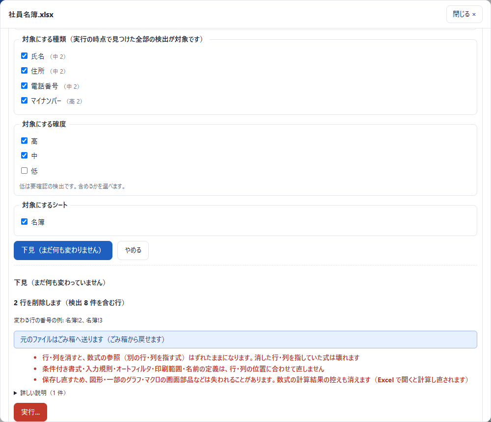

# 個人情報チェッカー（personal-info-checker）

**フォルダを指定して、個人情報を含んだファイルが存在するかを調べる Windows 用のツールです。**

手元のフォルダ・外付けのドライブ・NAS の共有フォルダなど、指定した場所の下にあるすべてのファイルを中身まで開いて調べ、マイナンバー・氏名・住所・電話番号・メールアドレス・口座番号などの個人情報と思われるものを一覧にします。結果は Excel・CSV のレポートにして渡せます。見つけたものには、画面から削除や置き換えで対処できます。

**調べたファイルや見つけた個人情報を、外へ送ることはありません。** 検査する場所を読むほかはどこにも接続せず、結果もこの PC の中にだけ保存します。


## 目次

- [すぐ使う](#すぐ使う)・[検査のしかた](#検査のしかた)・[結果の見かた](#結果の見かた)
- [見つけた個人情報への対処](#見つけた個人情報への対処)・[コマンドで使う](#コマンドで使う)
- [困ったとき](#困ったとき)・[できないこと・注意](#できないこと注意)・[もっと詳しく](#もっと詳しく)・[問い合わせ・開発者向け](#問い合わせ開発者向け)・[ライセンス](#ライセンス)

## すぐ使う

1. [Releases](https://github.com/AgemameSutachi/personal-info-checker/releases) から、一番上（いちばん新しい版）の `PiiChecker-<版>.zip` をダウンロードし、好きな場所に展開する
2. 展開した `PiiChecker` フォルダの `PiiChecker.exe` をダブルクリックする
3. 調べるフォルダを入れて「検査を始める」を押す

動作環境は Windows 10・11 の 64bit です。Python などを入れる必要はありません（zip は約 120MB、展開後は約 220MB）。初めて起動するとき「Windows によって PC が保護されました」と出たら、「詳細情報」→「実行」を押します。

いまの配布版はすべて**実験版**（Releases で「Pre-release」の印）です。まだ動作を保証できる段階ではないので、大事なファイルに対処する前は写しを取ってください。

## 検査のしかた

左上の「＋ 新しい検査」を押し、場所を指定して「検査を始める」を押します。

- **フォルダを指定する（ふだんはこちら）**: 「検査する場所の指定方法」で「フォルダを指定」を選び、「検査するフォルダ」に1行に1つずつ場所を入れます。手元（`D:\共有`）・外付けのドライブ・NAS の共有（`\\nas01\共有`）のどれでも指定できます。「フォルダを選ぶ…」で選ぶことも、フォルダを `PiiChecker.exe` に重ねて離すこともできます
- **接続方式を選ぶ**: ドライブにつないでいない NAS や FTP サーバーを、ユーザー名とパスワードで直接調べます。方式は SMB（Windows 共有・Samba）・FTP・FTPS（明示的・暗黙的）です。サーバー・共有名などを入れ、「接続を確かめる」で先に試してから始めます。接続のパスワードは保存しません
- **パスワード付きのファイル**: 暗号化された zip・Office ファイルのパスワードが分かっていれば、検査の前に1行に1つ入れます。分からなくても、検査の最後に「パスワードが必要なファイル」の欄が出るので、そこで1回入れれば全部に試します

画像の文字読み取り・前回の結果の使い回し・時間制限・拾わない値・自分で足す規則などの設定は [詳しい説明](docs/詳しい説明.md) にあります。

## 結果の見かた

検査の画面の一番上に**総合判定**が出ます。見つけたものには**確度**（個人情報である見込みの強さ。高・中・低）が付きます。

| 判定 | 意味 |
| --- | --- |
| 個人情報の可能性あり | 確度 高・中の検出がある。「個人情報の可能性があるファイル」を開いて確かめる |
| 言い切れない（調べられなかったものがある） | パスワード付き・破損・権限なしなど。「要対応」タブで原因を直して「再開」 |
| 要確認（確度の低い候補のみ） | 確度の低い候補だけ。「検出明細」で本当に個人情報か目で見る |
| 検出なし（一部は簡易検査） | 構造を読めず文字だけ見たものがある。「要対応」タブで確かめる |
| 検出なし（全ファイルを中身まで検査した） | 全ファイルを読めて、このツールが拾える形の個人情報は無かった（拾えない形は「[できないこと・注意](#できないこと注意)」） |

結果の表は7つのタブに分かれています: **要対応**（言い切りを妨げているもの）・**個人情報の可能性があるファイル**・**検出明細**（検出1件ずつ）・**全ファイル**・**全項目（中身を含む）**・**前回との違い**・**対処の記録**。行を押すと詳細が開き、そのファイルを読み直して検出した値そのものを見られます（「伏せて表示」にも切り替えられます）。

レポートは、「レポートを見る」（印刷・PDF 保存もできる）・「Excel に書き出す」・「検出明細（CSV）」で出せます。保存先と Excel・CSV には伏せた値だけが残ります。ただし**ファイルのパスと名前はそのまま載る**ので、渡し先に気をつけてください。

## 見つけた個人情報への対処

見つけた個人情報を、画面（アプリ版・Web 版）から消したり置き換えたりできます（コマンド版ではできません）。**検査そのものは何も書き込みません。人が方法を選んで実行したときだけ**、そのファイルを書き換えます。

> **先にお読みください**
> - **元の写しは作りません**（個人情報のファイルを手元のディスクへ写さないため）
> - ごみ箱のある場所では、元のファイルを「元の名前（対処前 日時）」にしてごみ箱へ送ります。**ごみ箱の無い場所（NAS・外付けなど）では、元のファイルは残りません**（下見に赤く出ます）
> - 大事なファイルは、バックアップやスナップショットがあることを確かめてから実行してください
> - 書き換えたあとにそのファイルを検査し直し、消した値が残っていれば取りやめます

### 手順

1. 検出のあるファイルの詳細を開き、「対処する…」を押す
2. 方法を選ぶ。対象にする種類と確度（シート・表も）、ダミー化なら作り方（同じ値は同じダミー／形を保つ／「＊＊＊」）も選ぶ
3. 「下見」で、変わる行・列・シートの数と例、注意、元のファイルの行き先を見る（ここではまだ何も変わりません）
4. 「実行…」を押し、対象のファイル名を確かめて「実行する」を押す
5. 結果（変わった数・残った検出・元のファイルの行き先）を見る。記録は「対処の記録」タブに残る（検出した値は書きません）



### 対処できる形式と方法

| 形式 | ファイルの削除 | 行の削除 | 列の削除 | ダミー化 | その他 |
| --- | --- | --- | --- | --- | --- |
| csv・tsv | ○ | ○ | ○ | ○ | |
| txt | ○ | ○ | － | ○ | |
| xlsx・xlsm | ○ | ○ | ○ | ○ | シートの削除 |
| SQLite・SQL のダンプ | ○ | ○ | ○ | ○ | 表の削除 |
| Access（.accdb・.mdb） | ○ | ○ | ○ | ○ | 表の削除 |
| Oracle のダンプ（旧 exp） | ○ | ○ | ○ | ○ | 表の削除 |
| Oracle のダンプ（expdp） | ○ | ○ | － | ○ | － |
| PDF | ○ | － | － | － | 黒塗り（文字ごと消す）・ページの削除 |
| Word（docx・docm） | ○ | ○（表の行） | ○（表の列） | ○ | 段落の削除 |
| PowerPoint（pptx・pptm） | ○ | － | － | ○ | スライドの削除 |
| 圧縮ファイルの中のファイル | ○ | 中身の形式に従う | 中身の形式に従う | 中身の形式に従う | 圧縮ファイルから取り除く |
| 上にないもの（xls・doc・ppt・pg_dump の -Fc など） | ○ | － | － | － | － |

- 圧縮ファイル（zip・7z・tar など）の中のファイルは、詳細の項目ごとの「…の中のこのファイルを対処する…」から、同じ手順で対処できます。圧縮ファイルは作り直され、元の圧縮ファイルは上の注意と同じ扱いになります
- **Access**: PC に Access の部品（ACE）があればそれで書き換えます。無ければ、.mdb は同梱の 32bit の Jet、.accdb は同梱の Java（Jackcess）で書き換えます。Jackcess では、列の削除は「列の値を空にする」、表の削除は「全行を消す（表の枠は残る）」になります
- Oracle のダンプは、書き換えたものを**テスト用のデータベースへ imp・impdp で読み込んで確かめてから**元の場所へ戻してください
- パスワード付きのファイル・簡易検査や検査不能のファイルは、中身の書き換えを選べません（理由が画面に出ます。ファイルの削除はできます）。読み取り専用のファイルと FTP の先のファイルは対処できません

### 元に戻す

「元に戻す」ボタンはありません。ごみ箱へ送ったときだけ、次の3手で戻せます。ごみ箱の無い場所で消した・入れ替えたものは戻せません。

1. 対処後のファイル（元の名前で残っている）を、別の名前にするか消す
2. エクスプローラーのごみ箱から「元の名前（対処前 日時）」のファイルを元の場所へ戻す
3. 戻したファイルの名前から「（対処前 日時）」を消す

## コマンドで使う

`PiiChecker` フォルダの中の `cmd\PiiChecker-cmd.exe` は、タスクスケジューラでの定期検査など、人が画面にいないときに使います。結果は画面の版と同じ場所に保存され、画面からも見られます。

```
# フォルダを検査して Excel と CSV を出す（無人で走らせるなら --no-ask を足す）
cmd\PiiChecker-cmd.exe scan \\nas01\総務 D:\共有 -o 結果.xlsx --csv
```

全部の引数は `cmd\PiiChecker-cmd.exe --help`（`scan --help` など）で見られます。パスワードのファイル・接続方式・中断した検査の続き・終了コードなどの例は [詳しい説明](docs/詳しい説明.md) の「コマンドの引数・終了コード・定期実行」にあります。

**Web 版**は `cmd\PiiChecker-cmd.exe serve` で起動します。合言葉入りの URL が表示され、ブラウザが開きます。既定では自分の PC からしか開けません。他の PC から開くときは `--host 0.0.0.0 --token <長い合言葉>` を付けます。**この場合は通信が暗号化されない（http）ので、信頼できる社内の回線だけで使い、使い終わったら止めてください。**

## 困ったとき

画面には日本語で原因と対処が出ます。よくあるものです。

| 症状 | 対処 |
| --- | --- |
| 検査できなかった（ファイルが見つからない・接続できない・アクセスが拒否された） | 場所の綴りと、そのアカウントでエクスプローラーから中が見えるかを確かめる。接続方式なら「接続を確かめる」で先に試す |
| 時間切れで検査不能 | 「1ファイルの時間制限」を延ばして再検査する。途中までの検出は記録され、残りは未検査として一覧に残る |
| 要パスワードが残る | 「パスワードが必要なファイル」の欄でパスワードを入れて「全部に試す」 |
| 途中で止まった（接続が切れた・ドライブの満杯） | 原因を直してから「再開」 |
| 対処で方法が選べない | 画面に理由が出る。パスワード付き・対応外の形式などは、ファイルの削除だけが選べる。読み取り専用のファイルは設定を外してから |
| 対処で断られた（ファイルが変わった・Access が開かれているなど） | 画面の理由を直してから、もう一度下見から始める。何も変わらずに断られている |
| 下見に「完全に削除」と出た | ごみ箱の無い場所（またはごみ箱が使えないドライブ）なので、元には戻せない。バックアップを確かめてから実行する |

接続できない・FTP のファイル名が化ける・画像が検査不能になるなどは、詳しい説明の「[困ったとき（接続の症状）](docs/詳しい説明.md#困ったとき接続の症状)」にあります。

## できないこと・注意

- 「検出なし」は、このツールが拾える形の個人情報が無いという意味です。氏名だけが単独で書かれた文・番地の無い住所・手がかり語の無い番号などは拾えないことがあります。基準は [詳しい説明](docs/詳しい説明.md) にあります
- 画像の文字読み取り（OCR）は、手書き・かすれ・小さい文字を読み落とすことがあります。日本語の「光学式文字認識」が Windows に入っていないと、画像は検査不能になります
- PST や読み解けない形のダンプは簡易検査（文字として読める部分だけ）、BitLocker のイメージは検査不能になります（一覧に理由つきで残ります）

## もっと詳しく

判定の基準・対応している形式・詳しい設定・形式ごとの対処・コマンドの全引数と終了コード・Python で動かす方法は [docs/詳しい説明.md](docs/詳しい説明.md) にあります。

## 問い合わせ・開発者向け

- 不具合・要望・質問は [Issues](https://github.com/AgemameSutachi/personal-info-checker/issues) へ。**実在する個人情報や検査したファイルそのものは貼らないでください**
- セキュリティの問題は公開の Issue にせず、[SECURITY.md](SECURITY.md) の方法で知らせてください
- 版ごとの変更は [CHANGELOG.md](CHANGELOG.md)、配布版の組み立て・試験・中の作りは [docs/開発者向け.md](docs/開発者向け.md) にあります

## ライセンス

このリポジトリのコードは MIT License です（[LICENSE](LICENSE)）。配布版は PyMuPDF（GNU AGPL-3.0）などを含むので、配布版の形で配るときは全体として AGPL-3.0 の条件（対応するソースの提供など。ソースはこのリポジトリ）に従ってください。同梱の部品（7-Zip・Java・Jackcess など）のライセンスと全文は、配布版の `THIRD-PARTY-LICENSES.txt` にあります（AGPL-3.0 の全文は [licenses/AGPL-3.0.txt](licenses/AGPL-3.0.txt)）。
