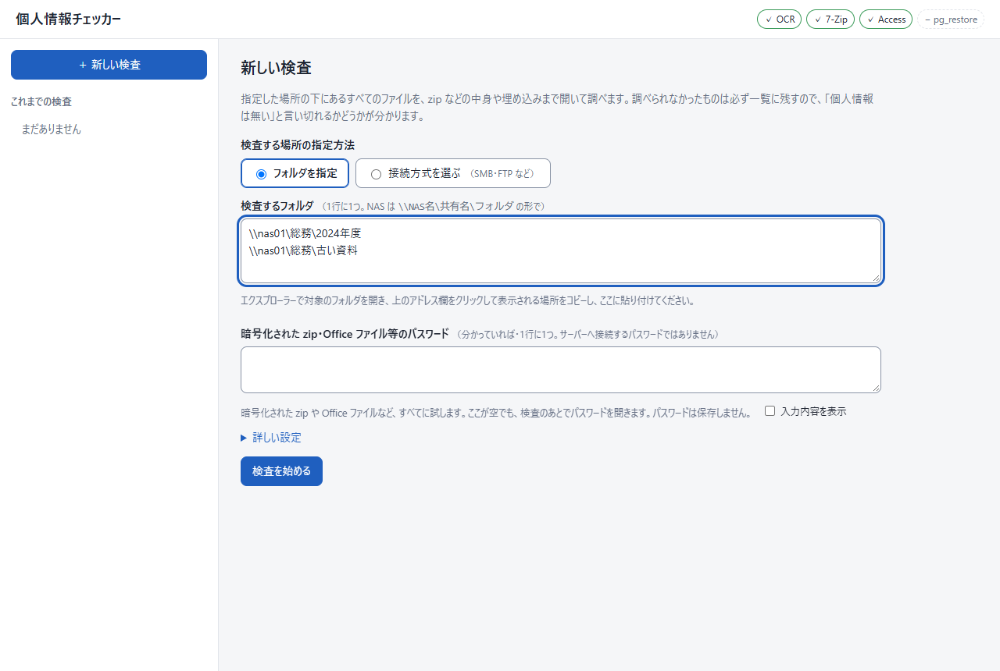
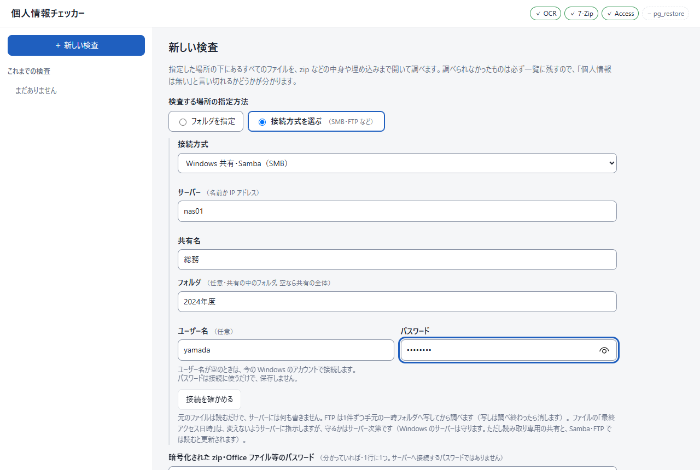
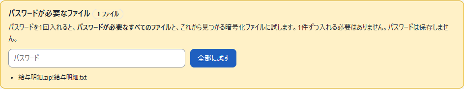
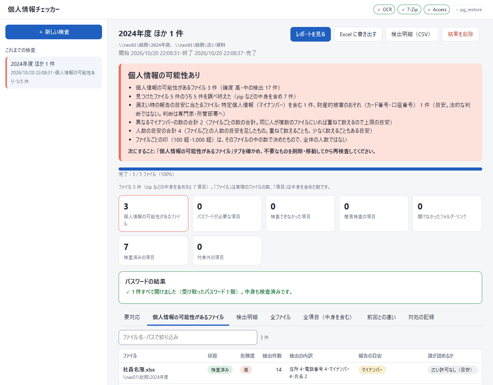
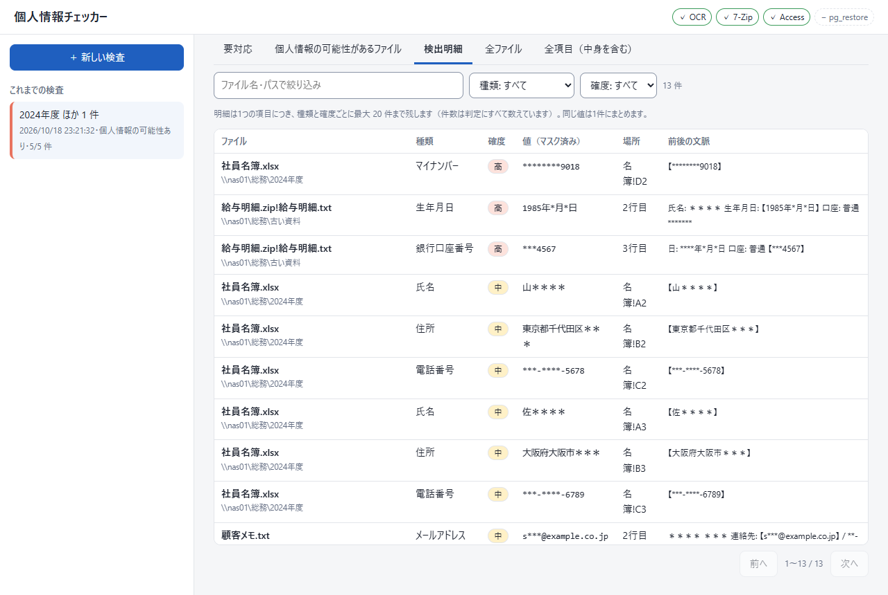
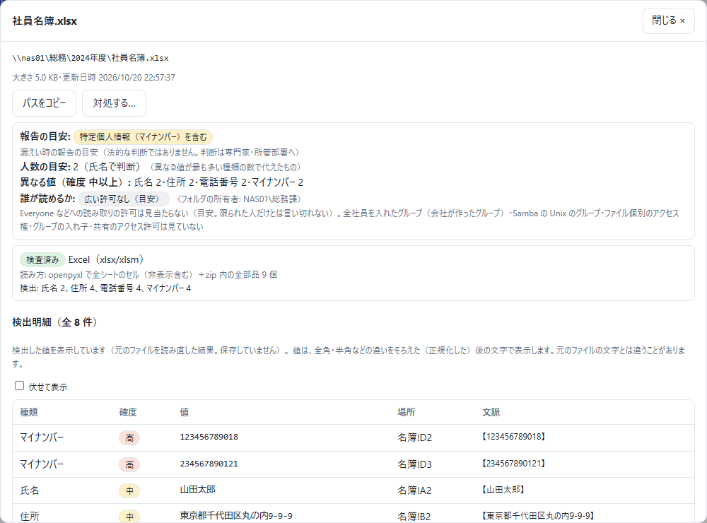
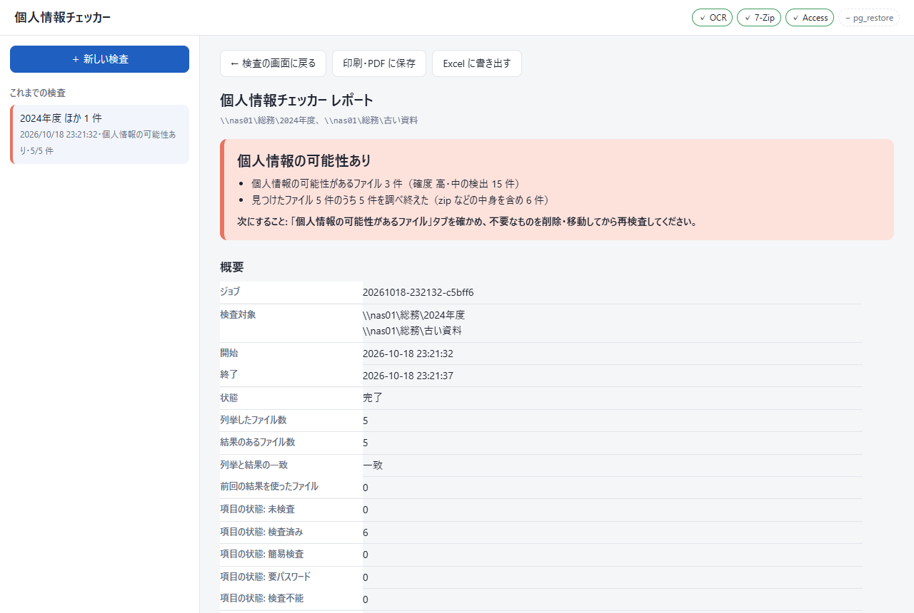
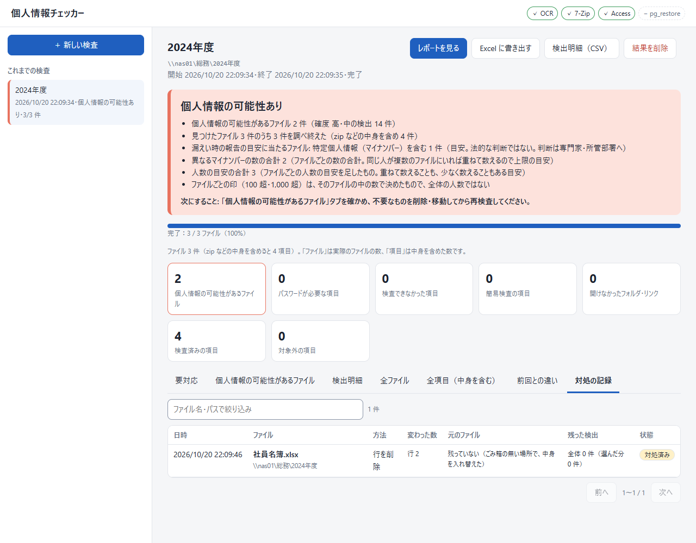

# 詳しい説明

[README](../README.md) の続きです。使い方の要点は README にあります。

## 目次

- [使い方の3通りと起動](#使い方の3通りと起動)
- [検査の詳しい設定](#検査の詳しい設定)・[接続方式の補足](#接続方式の補足)・[拾わない値・自分で足す規則](#拾わない値自分で足す規則)
- [結果の詳しい説明](#結果の詳しい説明)（状態・パスワード・タブ・レポート・報告の目安・誰が読めるか・前回との違い）
- [何を個人情報とみなすか（判定の基準）](#何を個人情報とみなすか判定の基準)
- [対応している形式](#対応している形式)
- [形式ごとの対処の詳しい説明](#形式ごとの対処の詳しい説明)
- [コマンドの引数・終了コード・定期実行](#コマンドの引数終了コード定期実行)
- [できないこと・注意（詳しく）](#できないこと注意詳しく)・[困ったとき（接続の症状）](#困ったとき接続の症状)
- [安全のための決まり](#安全のための決まり)・[Python で動かす](#python-で動かす)

## 使い方の3通りと起動

| 使い方 | 起動のしかた | 向いているとき |
| --- | --- | --- |
| アプリ版（デスクトップアプリ） | `PiiChecker.exe` をダブルクリック | ふだんはこれ |
| Web 版（ブラウザ） | `cmd\PiiChecker-cmd.exe serve` | ブラウザで操作したいとき |
| コマンド版 | `cmd\PiiChecker-cmd.exe scan …` | 定期実行・無人実行 |

- コマンド版・Web 版の exe は `PiiChecker` フォルダの中の `cmd` フォルダにあります。エクスプローラーで `PiiChecker` フォルダを開き、アドレス欄に `cmd` と打って Enter で出る窓から `cmd\PiiChecker-cmd.exe …` と打ちます
- アプリ版と Web 版は同じ画面です。WebView2 が無い PC では、アプリ版も同じ画面を既定のブラウザで開き、小さなメッセージの窓が出ます。**このメッセージの窓を閉じる（OK を押す）と検査が中断する**ので、検査が終わるまで閉じないでください
- **アプリ版は、検査中に窓を閉じると検査が中断します**（閉じる前に確認が出ます。あとで「再開」で続きから進められます）。Web 版はブラウザを閉じても検査は続き、コマンドの窓で Ctrl+C を押してサーバーを止めると中断します
- Web 版は起動すると合言葉入りの URL（`http://127.0.0.1:8765/?token=…`）を表示してブラウザを開きます。既定では自分の PC からしか開けません。IPv6 で待ち受けるときは `--host ::1` を付けます
- 結果は `%LOCALAPPDATA%\PiiChecker\jobs.sqlite3` に保存され、左の「これまでの検査」に並びます。不要になった結果は「結果を削除」で消せます（検査先のファイルは消えません。検査中は先に「中止」します）

**ほかの PC から Web 版を使うとき**:

```
cmd\PiiChecker-cmd.exe serve --host 0.0.0.0 --token <推測されにくい長い合言葉>
```

- ブラウザは自動では開きません。ほかの PC で、表示された URL の `127.0.0.1` をこの PC の名前か IP アドレス（`ipconfig` で確かめる）に置き換えて開きます（ポートは 8765）
- 通信は暗号化されません（http）。信頼できる社内の回線だけで使い、使い終わったら止めてください
- 初回に Windows のファイアウォールの確認が出たら、社内ネットワークで「許可」を選びます。出ない・つながらないときは、管理者に TCP 8765 番を開けてもらいます
- 調べる場所と SMB の接続は、**serve を動かしている PC から見た場所とアカウント**になります

## 検査の詳しい設定

### フォルダを指定する



場所は、エクスプローラーでフォルダを開き、上のアドレス欄をクリックして出る文字をコピーすると確実です。

### 接続方式を選ぶ



1. 「接続方式」を下の表から選ぶ
2. 「サーバー」（名前か IP アドレス）、SMB なら「共有名」、必要なら「フォルダ」を入れる。フォルダが空のとき、SMB は共有の全体、**FTP・FTPS はログインしたときの場所**（サーバー全体とは限らない）を調べる
3. 「ユーザー名」と「パスワード」を入れる。ユーザー名が空なら、SMB は今の Windows のアカウント、FTP は匿名でつなぐ
4. FTP・FTPS は「ファイル名の文字コード」、FTPS は「サーバーの証明書を確かめる」を必要に応じて変える
5. 「接続を確かめる」で、出てくる場所が調べたい所と合っているかを確かめてから「検査を始める」

| 接続方式 | 既定のポート | 使うとき |
| --- | --- | --- |
| Windows 共有・Samba（SMB） | 変えられない | Windows サーバー・NAS の共有フォルダ |
| FTP（暗号化なし） | 21 | 社内の古い FTP サーバー。パスワードが平文で流れる |
| FTPS（明示的 TLS・AUTH TLS） | 21 | 暗号化できる FTP サーバー（ふつうはこちら） |
| FTPS（暗黙的 TLS） | 990 | 990 番で待ち受けるサーバー |

### 接続方式の補足

- 接続のパスワードは保存しません。アプリを開き直してから中断した検査を再開するときは、もう一度聞かれます。サーバーが止まっている・回線が切れているときは理由だけが出ます。つながることを確かめてから、もう一度「再開」を押します
- SMB は Windows の接続でつなぎ（ドライブ文字は使いません）、`\\サーバー\共有` として調べます。エクスプローラー等で既に開ける共有は、その接続をそのまま使います
- FTP は1件ずつ手元の一時フォルダへ写して調べ、調べ終えたら写しを消します
- 読み取り専用の共有では、ファイルの最終アクセス日時がサーバー側で更新されます。保ちたいときは、属性の書き込みを許した検査用のアカウントで接続します
- NAS の自己署名の証明書では「証明書を確かめる」を外したまま使います（その分、成りすましには気づけません）

### 設定一覧

| 設定 | 既定 | 変えるとき |
| --- | --- | --- |
| 画像とスキャンした PDF を OCR で読む | 入 | 外すと画像は「検査不能」になり、言い切れなくなる |
| 前回から変わっていないファイルは前回の結果を使う | 入 | 書き換えが疑わしいときは外して全部読み直す |
| ディスクイメージの空き領域も調べる | 切 | 削除されたファイルまで調べたいとき（時間がかかる） |
| 同時に調べるファイルの数 | 自動 | NAS や PC が重いときに減らす |
| 1ファイルの時間制限 | 30 分 | 大きなファイルは大きさに合わせて自動で延びる（1秒あたり 512KB を最低の読む速さとみなす。3GB なら約100分）。git のリポジトリは通常の4倍。それでも時間切れになるときに延ばす。打ち切られても、途中までに見つけた分は記録される |
| 展開に使う一時フォルダ | Windows の一時フォルダ | 大きなディスクイメージを調べるときは空きの多いドライブへ |
| 拾わない値（許可リスト） | 空 | 自社の代表番号・所在地・書類の見本の名前などが、毎回「要確認」に並ぶとき |
| 自分で足す規則 | 空 | 社員番号・顧客番号など会社ごとの形の番号や、「機密」などの語も探したいとき |

### 拾わない値・自分で足す規則

- **拾わない値**は1行に1つ書きます。見つけた値がまるごと同じときだけ外します（一部だけ同じものは外しません）。全角と半角・空白・ハイフン・括弧の違いは無視し、氏名は「様」などの敬称を外して比べます。外した件数は総合判定とレポートに「拾わない値（許可リスト）で外した検出 N 件」と出ます（黙って消しません）。値そのものはレポートに載せません
- **自分で足す規則**は1行に1つ、`名前 | 探す語か正規表現 | 確度` の形で書きます（確度は 高・中・低。省けば 中）。例: `社員番号 | EMP-\d{6} | 中`・`顧客番号 | C\d{8}`・`機密`。見つかったものは種類「利用者の規則」として、規則の名前つきで明細に出ます（Excel・CSV では「検出規則」の列）。`#` で始まる行は読み飛ばします。「または」は `(?:EMP|STF)-\d{6}` のように括弧で囲みます
- 正規表現は複数行モードで当てます（`^`・`$` は行の頭・終わりに当たる）。全角の英数字は半角として扱い、全角の記号（`＊`・`（）` など）はその文字そのものとして探します
- 書き方の誤りは、検査を始める前に何行目が悪いかを示して断ります。検査が極端に遅くなる書き方（`(\d+)+`・後方参照・同じ文字に当たる長い繰り返しの連続など）も断ります。正規表現は 200 文字までです
- **入れた値は、次回の既定と再開のため、この PC の結果の保存先（`jobs.sqlite3`）にそのまま残ります**（レポートには件数と規則の名前だけが出て、値は出ません）。どちらかを変えた検査では、前回の結果を使い回しません

## 結果の詳しい説明

### 総合判定（上から順に当てはまるものが出る）

| 判定 | 意味 | すること |
| --- | --- | --- |
| 検査中 | まだ調べている | 終わるのを待つ（判定は途中の値） |
| 個人情報の可能性あり | 確度 高・中の検出がある | 「個人情報の可能性があるファイル」を開いて中身を確かめる |
| 言い切れない（検査を途中で止めた） | 1件も数えないうちに止まった | 止めた理由（NAS への接続など）を直してから「再開」 |
| ファイルが見つからない（言い切れない） | 1件も無かった | 場所の指定違い・権限で見えていないことを疑う |
| 言い切れない（調べられなかったものがある） | 調べられなかったものがある（理由の件数つき） | 「要対応」を開き、パスワードを入れる・権限を直すなど。「まだ調べていない」なら原因を直して「再開」 |
| 要確認（確度の低い候補のみ） | 確度の低い候補だけ | 「検出明細」で本当に個人情報か目で見る |
| 検出なし（一部は簡易検査） | 構造を読めず文字だけ見たものがある | 「要対応」タブで簡易検査のファイルを確かめる |
| 検出なし（全ファイルを中身まで検査した） | 読めなかったものは無く、このツールが拾える形の個人情報も無かった | なし（拾えない形は「[できないこと・注意（詳しく）](#できないこと注意詳しく)」） |

### ファイルごとの状態

すべてのファイル（zip の中身・埋め込み・添付も）に次のどれかが付きます。黙って飛ばすものはありません。

| 状態 | 意味 |
| --- | --- |
| 検査済み | 中身を構造ごと読んだ |
| 簡易検査 | 構造を解釈できず、文字として読める部分だけ見た（PST・読み解けない形の Oracle ダンプなど） |
| 要パスワード | パスワード候補を全部試しても開けない |
| 検査不能 | 破損・未対応・時間切れ・権限なし・OCR 不可など（理由と対処が出る） |
| 対象外 | 動画・音声・実行ファイル・フォント・分割アーカイブの2つ目以降 |

### パスワードが必要なファイル

暗号化されたファイルがあると「パスワードが必要なファイル」の欄が出ます。パスワードを入れて「全部に試す」を押すと、パスワードが必要なすべてのファイルと、これから見つかる暗号化ファイルに試します。1件ずつ入れる必要はありません。



開けると欄が「パスワードの結果」に変わり、中身も検査されて判定と件数が更新されます。



接続方式（ユーザー名あり）で調べた検査を、アプリを閉じて開き直してから見ているときは、「（接続先）のパスワード（ユーザー名）」の欄も出ます。ファイルを読み直すためにサーバーへつなぎ直すので、両方を入れてから「全部に試す」を押します（どちらも保存しません）。

### 結果の表（7つのタブ）

| タブ | 中身 |
| --- | --- |
| 要対応 | 言い切りを妨げているもの（要パスワード・検査不能・まだ調べていないもの・開けなかったフォルダ・辿らなかったリンク）と、簡易検査のもの |
| 個人情報の可能性があるファイル | 検出のあったファイルの一覧（報告の目安・誰が読めるかの列つき） |
| 検出明細 | 検出1件ずつ（種類・確度・値と前後の文脈・場所）。はじめは伏せた値で、行ごとの「値を表示」でそのファイルを読み直した値を出す |
| 全ファイル | 列挙したすべてのファイルと状態 |
| 全項目（中身を含む） | zip の中身・埋め込み・添付まで含めたすべて |
| 前回との違い | 同じ場所の前回の検査と比べて、新しく見つかった・無くなった・件数が増えた／減ったファイル |
| 対処の記録 | 画面から実行した対処の記録。元のファイルをごみ箱へ送ったか・残らなかったかも出る。値は書かない |

- 判定の下に並ぶ件数の枠を押すと、その内容のタブへ飛びます。表の上の欄でファイル名・パスで絞り込めます（検出明細は種類・確度でも）
- 検出明細は、1つの項目・1種類・1確度あたり20件まで載せ、同じ値は1件にまとめます（件数は全部数えます）
- 行を押すと詳しい内容が開きます。「パスをコピー」、アプリ版では「エクスプローラーで場所を開く」も使えます





### レポートの書き出し

- 「レポートを見る」: 結果をまとめたページ。「印刷・PDF に保存」で PDF にできる
- 「Excel に書き出す」: レポートと同じ中身の .xlsx（`個人情報チェッカー_<ジョブID>.xlsx`）。アプリ版は保存先を聞き、保存後に自動で開く。Web 版はブラウザのダウンロードに保存される
- 「検出明細（CSV）」: 検出1件ずつの CSV



| Excel のシート | 中身 | 画面では |
| --- | --- | --- |
| 判定 | 総合判定・件数・次にすること | 一番上の判定 |
| 要対応 | 言い切りを妨げているもの | 「要対応」タブ |
| ファイル別 | ファイルごとの状態・危険度・検出件数・報告の目安・異なる値の数・誰が読めるか | 「全ファイル」タブ |
| 前回との違い | 前回の検査と比べた違い | 「前回との違い」タブ |
| 検出明細 | 検出1件ずつ | 「検出明細」タブ |
| 全項目 | 中身・埋め込み・添付まで含めたすべて | 「全項目（中身を含む）」タブ |

レポートには「列挙したファイル数」と「結果のあるファイル数」の一致も載ります（取りこぼしが無い証拠）。

### 報告の目安・誰が読めるか・前回との違い

- **報告の目安**: ファイルごとに「特定個人情報（マイナンバー）を含む」「要配慮個人情報を含む」「財産的被害のおそれ（カード番号・口座番号）」「異なるマイナンバーが 100 を超える」「人数の目安が 1,000 を超える」の印が付きます。100 超・1,000 超の印は**そのファイルの中の数**で決めたものです。総合判定にはジョブ全体の「異なるマイナンバーの数の合計」と「人数の目安の合計」も出します（ファイルごとの数を足したもので、同じ番号が複数のファイルにあれば重ねて数えるため、目安です）。漏えいしたときに個人情報保護委員会への報告が要るかの**目安で、法的な判断ではありません**（暗号化などの措置の有無や、実際に漏えいしたかは、このツールには分かりません）。判断は専門家・所管部署へ。根拠は個人情報の保護に関する法律施行規則 第7条と、特定個人情報の漏えい等に関する報告等に関する規則 第2条です
- **異なる値の数**: 同じ値（全角半角・空白・ハイフン・氏名の敬称の違いは無視）を1つと数えた数です（確度 中以上）。値そのものは保存しません。人の数は分からないので、氏名・マイナンバー・メール・電話などのうち異なる値が最も多い種類の数を「人数の目安」とします
- **誰が読めるか**: 検出のあったファイルの親フォルダのアクセス権を読み、Everyone・Authenticated Users・Users・Domain Users などに読み取りが許されていれば「広く読める」、見当たらなければ「広い許可なし（目安）」、読めなければ「読めなかった」と出します（FTP は「取れない」）。「広い許可なし」は**限られた人だけとは言い切れません**: 全社員を入れたグループ・Samba の Unix のグループ・ファイル個別のアクセス権・共有のアクセス許可は見ていません。読むだけで何も変えません
- **前回との違い**: 同じ場所（同じフォルダの組、または同じ方式・サーバー・ポート・共有・フォルダ）を最後まで終えた前回の検査と比べ、新しく見つかった・無くなった・件数が増えた／減ったファイルを出します。定期の点検で、毎回全部を見直さなくて済みます
  - 「無くなった」には理由が付きます: 検出が無くなった（直した・中身が変わった）／今回は見つからない（消した・移した・名前を変えた、または今回は見えなかった）／今回は調べられなかった（要パスワード・検査不能・まだ調べていない・開けなかったフォルダの下）。直ったと言えるのは、検出が無くなったものだけです
  - 前回と、拾わない値・自分で足す規則・OCR などの設定や検査器の版が違うときも比べますが、違いにファイルの変化でないものが含まれることを添えて示します

## 何を個人情報とみなすか（判定の基準）

個人情報かどうかは、次の3つの手がかりを組み合わせて決めます。全角の数字・英字は半角にそろえてから調べます。

1. **値の形と検査数字**: 桁数・区切り方に加え、マイナンバーの検査数字や、クレジットカードの Luhn 検査が合うかを確かめる（でたらめな12桁はマイナンバーにしない）
2. **前後の手がかり語**: 値の前後（前は約20文字以内、後ろは数文字以内）に「個人番号」「免許証」「口座」「電話」「生年月日」などの語があるか
3. **表の列見出し**: Excel・Access・CSV・Word の表では、列見出し（「氏名」「住所」「電話番号」など）から列の意味を決め、その列の値を形に関係なく数える

見つけたものには確度を付けます。**高・中**が1件でもあれば総合判定は「個人情報の可能性あり」、**低**だけなら「要確認」です（調べられなかったファイルがあるときは「言い切れない」が先に出ます）。

### 種類ごとの基準

| 種類 | 個人情報とみなす条件 | 確度 | 拾わないもの |
| --- | --- | --- | --- |
| マイナンバー | 12桁（4桁ずつの区切りも可）で、検査数字が合う | 近くに「個人番号」「マイナンバー」「通知カード」の語か、その列見出しがあれば 高。手がかりが無ければ 低（フリーダイヤルの番号の形に見えるものも 低）。語があるのに検査数字が合わない12桁は 低（明細に「打ち間違いの可能性」と出る） | 語の無い、検査数字が合わない12桁。全部同じ数字。近くに「免許」の語があるもの（運転免許証番号として拾う） |
| クレジットカード番号 | 13〜19桁で、Luhn 検査が合い、ブランドの番号体系（VISA・Mastercard・AMEX・JCB・Diners・Discover）に合う | 近くに「カード」「クレジット」「VISA」などの語・列見出しがあるか、4桁ずつ区切ってあれば 高。「注文」「品番」「型番」などの近くは 低。それ以外は 中。「カード番号」の語があるのに Luhn 検査が合わない13〜19桁は 低 | Luhn 検査やブランドの体系に合わない番号 |
| 銀行口座番号 | 「口座」「口座番号」「普通」「当座」「普通預金」の語の後（12文字以内）の7桁。「金融機関コード-支店番号-口座番号」（4桁-3桁-7桁）も | 高 | 後ろに「円」「,」が続くもの、口座の語と数字のあいだに「残高」「金額」「入金」などがあるもの（金額とみなす） |
| 運転免許証番号 | 「運転免許」「免許証」「免許番号」「免許証番号」の語の後（12文字以内）の12桁 | 高 | 語の無い12桁（マイナンバーの基準で調べる） |
| 旅券番号 | 「旅券」「パスポート」「passport no」の語の後の、英字2文字＋数字7桁 | 高 | 語の無いもの |
| 基礎年金番号 | 「基礎年金番号」「年金番号」の語の後の、4桁＋6桁 | 高 | 語の無いもの |
| 保険証の記号番号 | 「被保険者番号」「保険者番号」「記号番号」「保険証番号」の語の後の、数字を含む4〜20文字 | 中 | 語の無いもの。近くに「雇用保険」の語があるもの |
| 在留カード番号 | 「在留カード」の語の後（12文字以内）の、英字2＋数字8＋英字2 | 高 | 語の無いもの |
| 住民票コード | 「住民票コード」の語の後（12文字以内）の11桁 | 高 | 語の無いもの・桁数の違うもの |
| 雇用保険被保険者番号 | 「雇用保険被保険者番号」「雇用保険番号」の語の後の、4桁-6桁-1桁（区切りの無い11桁も） | 高。形が違う番号は 中 | 語の無いもの |
| 会員・社員などの番号 | 「社員番号」「職員番号」「従業員番号」「会員番号」「顧客番号」「お客様番号」「学籍番号」「患者番号」「診察券番号」の語の後の、数字を含む4〜20文字の英数字。これらが列見出しなら、その列の値 | 低 | 数字を含まないもの。後ろに「年」「件」などの単位が続く数 |
| 要配慮個人情報 | 「病名」「病歴」「既往歴」「診断名」「傷病名」「障害等級」「障害者手帳」「犯罪歴」「前科」「信仰」「宗教」「信条」「本籍」の語＋「：」＋記載 | 中 | 「：」の無い文中の言及（例「病名は不明」） |
| 氏名 | (a)「氏名」「お名前」「名前」「患者名」「顧客名」「担当者」「宛名」「フリガナ」などの語＋名前 (b) よくある姓＋敬称（様・殿・さん・君・くん・ちゃん） (c) 漢字3〜5文字＋「様」「殿」 (d) よくある姓＋空白＋名 | (a) 中 (b) 敬称を含めて4文字以上は 中、未満は 低 (c)(d) 低 | 「お客様」「各位」「ご担当者様」など人を指さない言い方。手がかりの無い名前だけの文 |
| 住所 | **都道府県＋市区町村＋番地まで**（「○丁目」「○番地」「○番」「○号」「1-2-3」のどれか。漢数字も可）。例「東京都千代田区丸の内9-9-9」 | 人と結びつくときだけ 中（下の「住所の確度の決め方」）。それ以外と、都道府県を省いた形は 低 | 番地の無いもの（「東京都千代田区」だけ）。町名の後に数字だけのもの。いずれも表の「住所」列の中なら拾う |
| 郵便番号 | 「〒」＋7桁、または「3桁-4桁」の直後に都道府県名が続くもの | 中 | 「〒」も都道府県も無い7桁 |
| 電話番号 | 携帯（050・070・080・090）: 区切りがあるか、近くに「電話」「TEL」「携帯」「連絡先」などの語。+81 の形も。固定電話（10桁）: 近くに電話の語 | 携帯は 中。固定電話は、近くに「自宅」「緊急連絡」などがあるか、同じファイルに人の手がかりがあるときだけ 中、無ければ 低。区切りも語も無い携帯の11桁、会社の代表番号らしい固定電話（「株式会社」「本社」「代表」「支店」などが近くにある）は 低。型番・品番などの語の近くは 低 | 0120・0800・0570・0990 で始まる番号。区切りも語も無い固定電話の10桁 |
| メールアドレス | 「名前@ドメイン」の形 | 中。info@・support@・noreply@・sales@ などの窓口用は 低 | |
| 生年月日 | 「生年月日」「誕生日」「生まれ」「DOB」の語＋日付（西暦・和暦） | 高。語が無くても昭和・平成・大正の和暦の日付は 低 | 語の無い西暦の日付 |
| 性別・年齢 | 列見出しが「性別」「年齢」の列の値だけ | 低 | 文中の「男性」「30歳」など |
| 本人確認書類の写し | 文字認識（OCR）で読んだ画像1枚・PDF の1ページに、書類の名前と決まった語が揃う（運転免許証・個人番号カード・在留カード・被保険者証・旅券） | 高（値は書類の名前） | Word・Excel・テキストなど OCR でない文字 |

### 住所の確度の決め方

住所は、公共施設の所在地や番地の一覧のように個人と関係なく書かれることが多いため、**個人と結びつく手がかりがあるときだけ確度 中**にします。手がかりが無い住所も消さずに確度 低で残すので、総合判定は「要確認」になり、黙って見落とすことはありません。

| 状況 | 確度 | 例 |
| --- | --- | --- |
| 住所の近くに「自宅」「現住所」「本人」「実家」「お届け先」「送付先」「宛先」「勤務先」などの語がある | 中 | 「自宅 東京都千代田区丸の内9-9-9」 |
| 同じファイルに、確度 中以上の氏名・生年月日・マイナンバー・口座・免許証・携帯電話番号などの人の手がかりがある | 中 | 顧客名簿、申込書 |
| ファイル名か本文の先頭（300文字）に、人の情報を集めた書類の題（履歴書・名簿・連絡網・申込書・住所録・顧客・会員・社員・患者・カルテなど）がある | 中 | 「住所録.xlsx」 |
| 住所の前（同じ行・同じセルの30文字以内）に施設・会社の語（所在地・市役所・図書館・学校・病院・駅・株式会社・本社・支店など）がある | 低（同じファイルに氏名があっても 低） | 「中央図書館 東京都千代田区丸の内9-9-9」 |
| 上のどれにも当たらない（住所だけが並ぶ） | 低 | 番地の一覧 |

- 「自宅」などの語と施設の語が両方あれば、「自宅」などを優先して 中 にします
- 「駅前」「最寄駅」などは施設の語にしません
- 手がかりはファイル（Excel のブック・Access のデータベース・zip の中の1ファイル）ごとに1つです。氏名の無い配送先の一覧なども 低（要確認）になるので、「要確認」のファイルは目で見て判断してください
- 固定電話・メールアドレス・郵便番号は施設の一覧にも普通に載るので、人の手がかりにはしません

### 例

| 書かれている文字 | 判定 |
| --- | --- |
| 東京都千代田区 | 拾わない（番地が無い） |
| 東京都千代田区丸の内9-9-9 | 住所（人の手がかりがあれば中・無ければ低） |
| 長野県北佐久郡軽井沢町長倉1234 | 拾わない（番地が数字だけ） |
| 大阪市北区梅田2-2-2 | 住所（低・都道府県なし） |
| 免許証番号 123456789012 | 運転免許証番号（高） |
| マイナンバー 123456789018 | マイナンバー（高） |
| 123456789018（語なし・検査数字は合う） | マイナンバー（低） |
| 123456789012（検査数字が合わない） | 拾わない |
| 病名：糖尿病 | 要配慮個人情報（中） |
| 病名は不明 | 拾わない |
| 生年月日 1985年4月1日 | 生年月日（高） |
| 昭和60年4月1日 | 生年月日（低） |
| 2024年4月1日 | 拾わない |
| 〒100-0001 | 郵便番号（中） |
| 鈴木一郎様／鈴木さん | 氏名（中） |
| 鈴木様／鈴木 一郎 | 氏名（低） |
| お客様 | 拾わない |
| 090-1234-5678 | 電話番号（中） |
| 株式会社サンプル 代表 03-1234-5678 | 電話番号（低・会社の代表番号らしい） |
| 自宅 03-1234-5678 | 電話番号（中） |
| 0120-123-456 | 拾わない |
| 口座 普通 1234567 | 銀行口座番号（高） |
| 口座残高 1234567円 | 拾わない（金額） |
| taro@example.com／info@example.com | メールアドレス（中）／（低） |

### 表の列見出しによる判定

- 列見出しが個人情報の語（上の表の語や「社員名」「会員氏名」「携帯」「メール」など）なら、その列の値を、形が上の基準に合わなくても数える。確度はふつう 中。マイナンバー（検査数字が合う）・クレジットカード（Luhn 検査が合う）・口座・免許証・旅券・生年月日（日付の形）は 高、性別・年齢は 低
- 「お客様名」「契約者」「申込者」「送り主」「依頼主」「届け先名」「加入者」の列も氏名の列にする
- 「会社名」「商品名」「品名」「店舗名」「部署名」「ファイル名」「作成者」などは、「名」を含んでも個人情報の列にしない
- 横に並べた申込書の形（左のセルが「氏名」、右のセルが値）も、左隣のセルを見出しとして使う
- 英語の `NAME` 列は、品名の列でも氏名（確度 中）として挙がる

### ファイルの危険度

| 危険度 | 条件 |
| --- | --- |
| 高 | マイナンバー・クレジットカード・銀行口座・運転免許証・旅券・基礎年金番号・保険証・在留カード・住民票コード・雇用保険被保険者番号・本人確認書類の写し・要配慮個人情報のどれかが確度 中以上で1件でもある。または生年月日が確度 高で見つかった。または確度 中以上の検出が合わせて100件以上ある（確度 低 だけなら何件あっても「高」にしない） |
| 中 | 上に当たらず、確度 中の検出がある |
| 低 | 確度 低の検出だけ |

## 対応している形式

| 種類 | 形式 |
| --- | --- |
| Office | xlsx・xlsm・xlsb・xls・docx・doc・rtf・pptx・ppt・ods・odt（非表示シート・コメント・変更履歴・文書プロパティも） |
| PDF | 本文・注釈・フォーム欄・添付ファイル。文字の無いページ（スキャン）は文字認識で読む |
| 画像 | png・jpg・gif・bmp・tif・webp（Windows 標準の文字認識（OCR）で日本語を読む） |
| Access・DB | accdb・mdb（Access 97 から）・SQLite・dBase・PostgreSQL ダンプ・mysqldump などの SQL・Oracle ダンプ（exp／expdp。圧縮・暗号化したものは簡易検査） |
| メール | eml・mht・msg（添付も）・PST/OST（簡易検査） |
| 圧縮ファイル | zip（日本語名・暗号化）・7z・rar・lzh・cab・tar・gz・bz2・xz・zst など（入れ子も） |
| ディスクイメージ | ISO・WIM・VHD/VHDX・VMDK・VDI・QCOW2・DMG など |
| その他 | テキスト・CSV（文字コードは自動判定）・git リポジトリ（過去の版まで）・NTFS の代替データストリーム |

画面の右上の札（OCR・7-Zip・Access・pg_restore）は、この PC で使える部品を示します。使えない部品が要る形式は「検査不能」として理由つきで一覧に残ります。Access は、この PC に Access の部品（ACE）が無くても、同梱の部品（.mdb は 32bit の Jet、.accdb は Java の Jackcess）で読みます。画像の文字は Windows 標準の OCR で読むため、日本語の「光学式文字認識」が入っていない PC では画像が「検査不能」になります。

## 形式ごとの対処の詳しい説明

方法の一覧は README の「対処できる形式と方法」にあります。

### 共通のこと

- **ファイルの削除**: ごみ箱のある場所（Windows のごみ箱）では、ごみ箱へ送ります。下見の1行目は「ファイル「X」をごみ箱へ送ります（ごみ箱から戻せます）」です。ネットワーク・外付けなど**ごみ箱の無い場所**では、そのまま消します。下見の1行目は「ファイル「X」を完全に削除します（この場所にはごみ箱がありません。元に戻せません）」で、警告にも同じ旨が出ます。ごみ箱を無効にしたドライブ・Google Drive などの仮想ドライブでは、送ったつもりで実は完全に削除されることがあるため、送ったあとにごみ箱に入ったかを確かめ、入っていなければ「完全に削除した」と記録・表示します。ごみ箱の容量より大きいファイルは完全に削除になり、そのときだけ Windows の確かめの窓が出ます（「いいえ」で対処を取りやめ）
- **該当行・列の削除**: 行は、選んだ種類・確度の検出を含む行。列は、検出を含む列（csv・tsv だけ）。xlsx の行・列の削除は保存し直すため、数式の参照・条件付き書式・入力規則・名前の定義は位置に合わせて直しません。図形・一部のグラフ・マクロの画面部品などが失われることがあります（下見に出ます）
- **ダミー化**: 検出した値の部分だけを置き換えます。作り方は3つ: ①同じ値は同じダミー（種類の名前と8桁の符号。実行ごとのランダムな鍵で作り、鍵は保存しない。表の中の突き合わせが壊れない）②形を保つ（数字は 0、文字は 〇、区切りの記号は残す。`090-1234-5678` は `000-0000-0000`）③固定の「＊＊＊」。xlsx のダミー化は対象のセルだけを書き換えるので、書式・グラフ・ピボット・図形・マクロは壊れません（セルは文字列になり、数式のセルは書き換えません）
- csv・tsv・txt は、文字コード・BOM・改行・区切り・引用符の付け方を元のまま保ちます
- 下見の注意は、赤い太字（消える・戻せない・壊れうるもの）と、仕組み・保たれるもの（「詳しい説明」の折りたたみ）の2種類です。元のファイルの行き先は帯で示します（ごみ箱へ送る＝青、完全に削除・元が残らない＝赤）。対処のあと、そのファイルの検出明細は「対処前の結果」の帯つきで伏せた値に戻り、検査し直すと最新になります
- 途中で落ちても（アプリの強制終了・電源断）、元の中身か新しい中身のどちらかが必ず元の名前（か「対処前」の名前）で残り、アプリの起動時と同じファイルへの次の対処の前に立て直します。立て直した内容は「対処の記録」に出ます。判断できないときは、どちらのファイルも消さずに残します
- 書き換えたファイルには、元の属性（隠し・システムなど）・作成日時・アクセス権・代替データストリームを引き継ぎます。引き継げなかったものは結果の知らせに出ます（Windows の暗号化（EFS）は引き継げません）



### できない・選べないもの

- 読み取り専用のファイル・FTP の先のファイル・パスワード付き（暗号化）のファイル（検査のとき入れたパスワードがある PDF は、同じパスワードで暗号化し直して書き換えられます）・中身を最後まで構造どおりに読めなかったファイル・対応していない形式は、中身の書き換えを選べません
- 位置の数が 200 万件を超えるファイル、256MB を超える csv・tsv・txt は中身を書き換えません（ファイルの削除はできます）
- 位置を持たない検出（内側のファイル・ファイル名・画像の中の文字など）は、この対処では変わりません。検査し直しで「残り」として出ます
- UTF-8・Shift_JIS・EUC-JP・UTF-16 以外の文字コードの csv・txt は書き換えません
- 検査の結果（検出の一覧）は、対処しても対処の前のままです。反映するには検査し直します
- 下見のあとにファイルが変わっていたら、書き換えも削除もしません。同じファイルは、別のジョブからも同時に対処できません。パスが 260 文字以上でごみ箱へ送れないファイルは、始める前に断ります

### データベース（SQLite・SQL のダンプ・Oracle のダンプ・Access）

「表の削除」は、検出した行だけでなく、その表のデータがすべて消えます。対象にする種類・確度に加えて、「対象にする表」も選べます。

- **SQLite**: 元のファイルは開いて書き換えず、写しに対して行の削除・列の削除・ダミー化・表の削除を当てます。終わりに空き領域も詰めるので、消した値がファイルの空きに残りません。外部キーの連鎖削除は動かしません。主キー・索引・外部キー・CHECK 制約・ビュー・トリガーに使われている列は、削除を断られることがあります（下見に注意が出ます。断られたら何も変わりません）。元のそばに `-wal`・`-shm`・`-journal` の付属ファイルがあるときは、他のプログラムが開いている可能性があるので断ります。仮想表（FTS など）と管理用の表は書き換えません
- **SQL のダンプ**（pg_dump の平文・mysqldump・INSERT 文の `.sql`。巨大でも）: 1行ずつ読みながら新しいファイルへ書くので、メモリに載せません。触らない行は元のまま写し、文字コード・改行を保ちます。列の削除では、その列を使う索引・制約の文も取り除きます。ほかの表の外部キーがその列・表を参照している場合は、読み込み時に失敗します。読み解けない INSERT 文を書き換える必要があるときや、CREATE TABLE が「1行に1列」の形でないときの列の削除は、壊さずに断ります。pg_dump のカスタム形式（-Fc）・ディレクトリ形式は、ファイルの削除だけです
- **Access（.accdb・.mdb）**: 元のファイルは開いて書き換えず、写しの中を直接書き換えます。**フォーム・マクロ・レポート・VBA・クエリ・リレーションシップ・索引など、表以外のオブジェクトはそのまま残ります**。使える手段を次の順に自動で選びます（下見に「使う手段」が出ます）
  - **ACE**（64bit の Access Database Engine がある PC）: 行・列・表を削除し、終わりに Access の最適化をかけます
  - **Jet 4.0**（.mdb で ACE が無いとき）: 同梱の 32bit の部品で同じ操作をします。Access 97 の .mdb もこちらです
  - **Jackcess**（ACE の無い .accdb）: 同梱の Java 実行環境で動かします。表・列そのものは消せないので、**表の削除は全行の削除（表の枠は残る）、列の削除は全行の値を空に（列は残る。必須の列は空にできず失敗する）**で代えます。消した行の跡・空き領域・メモなどの本文は 0 で塗りつぶします
  - どの手段でも、**書き換えたあとの写しに、選んだ値が文字の並びのまま残っていれば、確定せずに取りやめます**。ほかの行・列に同じ値がある場合も取りやめます（範囲を広げるか、ファイルの削除を選んでください）。3 文字より短い値と、数値・日付として保存された値は、この確かめの対象にしません
  - ダミー化は文字・整数の列だけです（日付・実数などは、行や列の削除を選んでください）
  - リレーションシップの「連鎖削除」で、選んでいない表の行まで消えるときは取りやめます。その列・表を使うフォーム・クエリ・レポートは、あとで動かなくなることがあります。データベースパスワードの掛かった Access、元のそばに `.laccdb`・`.ldb` のロックファイルがあるとき（Access などが開いている）、書き換えの手段がどれも使えない PC では、書き換えを選べません（理由が画面に出ます。ファイルの削除はできます）
- **Oracle のダンプ（旧 exp・expdp）**: 表の区画ごとに読みながら新しいファイルへ書くので、数 GB でもメモリに載せません。**書き換えたダンプは、そのまま使わずに、テスト用のデータベースへ imp（旧 exp）・impdp（expdp）で読み込んで確かめてから、元の場所へ戻してください**（このアプリは Oracle へ読み込んで確かめることはしません）。圧縮・暗号化したダンプ、表として最後まで読み解けなかったダンプは、壊さずに断ります（ファイルの削除だけ）
  - **旧 exp**: 行の削除・列の削除・ダミー化・表の削除。書き換えた表の統計（列の最小値・最大値に元の値が入っています）は取り除きます
  - **expdp**: 行の削除とダミー化だけです。列の定義が圧縮された管理情報の区画に入っていて書き換えられないため、列の削除・表の削除は選べません。**圧縮された管理情報の区画（列の統計の最小値・最大値など）に元の値が残っていることがあります**。完全に消したいときは、EXCLUDE=STATISTICS を付けて取り直したダンプを使ってください

### PDF・Word・PowerPoint

- **PDF の黒塗り**: 見た目だけを隠す注釈ではなく、ページの内容から**文字そのものを取り除き**、その場所を黒く塗ります。コピーしても、文字の抽出をしても、値は出てきません。**元に戻せません**。画像の中の文字を OCR で読んだ検出は、画像のその部分を黒く塗りつぶします（少し広めに塗ります）。塗ったあとで値がページの文字から減ったことを確かめ、減っていなければ何も確定しません
  - 文書情報（作成者・題など）・注釈・フォーム欄・しおり・リンク・埋め込みファイルに、消した値が残っていれば、それも取り除きます。ページの縮小画像も外します
  - 保存は全体を書き直すので、消した文字が古い版としてファイルに残りません。ファイルの内部の作りは変わります
  - パスワードで暗号化された PDF は、検査のとき入れたパスワードで開き、同じパスワードで暗号化し直して保存します（パスワードが手元に無いときは断ります）
  - 「ページを削除」は、検出のあるページを丸ごと取り除きます（すべてのページは削除できません）。文字の層の作りが特殊で黒塗りで文字が消えない PDF は、何も変えずに断ります
- **Word（docx・docm）**: ほかの部品はそのまま写します。ダミー化は、値が複数の文字の塊に割れていても置き換え、表のセル・ヘッダー・フッター・脚注・コメント・テキストボックスの中も対象です。変更履歴の削除した文字の中の値も置き換えるので、履歴に元の値が残りません。「該当の段落を削除」は、表のセルなどの最後の1つの段落と節の区切りを持つ段落は、取り除かずに中身を空にします。「表の行・列の削除」は表の中の検出が対象で、結合したセルに検出がある列は削除できません。書き換えのあと、文書のプロパティ・代替テキスト・グラフなどに消した値が残っていれば取り除き、縮小画像（サムネイル）も取り除きます
- **PowerPoint（pptx・pptm）**: ダミー化（スライドとノート）と「該当のスライドを削除」。スライドを削除すると、ノートと、ほかで使われていない画像・グラフ・埋め込みも取り除き、ほかのスライドからのジャンプのリンクは外します（すべてのスライドは削除できません）
- **旧形式（doc・ppt・xls）**・パスワードで暗号化された Office 文書は、ファイルの削除だけです。docx・pptx に変換してから検査し直すと、中身の対処ができます

### 圧縮ファイルの中のファイル

圧縮ファイル（zip・7z・rar など。入れ子も）の中のファイルを、圧縮ファイルの詳細の項目ごとの「…の中のこのファイルを対処する…」から、実ファイルと同じ手順で対処できます。

- **方法**: 中のファイルが csv・tsv・txt・xlsx・xlsm・pdf・docx・pptx なら、上と同じ方法。中のファイルの形式を問わず「**圧縮ファイルから取り除く**」。圧縮ファイルごとの削除もあります
- **作り直し**: 対象の項目だけを取り出して対処し、圧縮ファイルを作り直して検査し直します。元の圧縮ファイルは「元の名前（対処前 日時）.拡張子」にしてごみ箱へ送ります（ごみ箱の無い場所では残りません）。ほかの項目は取り出さずに写します。同じ圧縮ファイルの別の項目も対処するときは、1項目ずつ実行します

| 圧縮ファイルの形式 | 中のファイルの対処・取り除き | 作り直し方 |
| --- | --- | --- |
| zip（jar などを含む） | ○ | ほかの項目は変えずに写します（日時・圧縮方式・属性・名前・並びも同じ） |
| パスワード付き zip（ZipCrypto・AES） | ○（検査のときに入れたパスワードがあるとき） | 同梱の 7-Zip で同じ暗号方式・同じパスワードで入れ直します。パスワードに英数字・記号以外の文字があると入れ直せません |
| 7z（暗号化も） | ○（暗号化は検査のときのパスワードが要る） | 同梱の 7-Zip で更新します。圧縮方式・暗号化は元に合わせます |
| tar・tar.gz・tgz・tar.bz2・tar.xz | ○ | 日時・権限・所有者などを保って作り直します |
| gz・bz2・xz（1ファイル） | 中身の書き換えだけ | 書き換えた中身を、同じ形式で包み直します |
| rar・cab・iso・wim・lzh・arj・zstd など | 「zip に作り直す」と一緒にだけ | 書けない形式です。「**zip に作り直す**」を選ぶと、同じフォルダに「元の名前.zip」を作り、元の圧縮ファイルは消します（同じ名前があれば断る。パスワード付きは断る） |

- 署名つきの圧縮ファイル（jar の署名など）は、作り直すと署名が壊れる旨を下見に出します
- 7-Zip は同梱のものを使います。7-Zip が無いと、パスワード付き zip・7z・rar などは扱えません

## コマンドの引数・終了コード・定期実行

```
# フォルダを検査して Excel と CSV を出す
cmd\PiiChecker-cmd.exe scan \\nas01\総務 D:\共有 -o 結果.xlsx --csv

# 分かっているパスワードをファイルで渡す（UTF-8・1行1つ）
cmd\PiiChecker-cmd.exe scan \\nas01\総務 --password-file pw.txt

# 無人で走らせる（最後にパスワードを聞かない）
cmd\PiiChecker-cmd.exe scan \\nas01\総務 --no-ask -o 結果.xlsx

# 接続方式で指定する（パスワードはコンソールで聞かれる）
cmd\PiiChecker-cmd.exe scan --connect smb --host nas01 --share 総務 --path 2024年度 --user taro

# 中断した検査の続き・一覧・レポートの出し直し
cmd\PiiChecker-cmd.exe scan --resume <ジョブID>
cmd\PiiChecker-cmd.exe jobs
cmd\PiiChecker-cmd.exe report <ジョブID> -o 結果.xlsx
```

| 引数 | 意味 |
| --- | --- |
| `-o` / `--output` | レポート（.xlsx）の出力先。省くとドキュメントへ `個人情報チェッカー_<ジョブID>.xlsx` |
| `--csv` | `検出明細_<ジョブID>.csv` と `全項目_<ジョブID>.csv` も、xlsx と同じフォルダへ出す |
| `--resume <ジョブID>` | 中断した検査の続きから進める（ジョブID は `jobs` で分かる）。接続方式の検査では接続のパスワードをもう一度聞く |
| `--password-file` | 試すパスワードの一覧。`--resume` と一緒に使うと、後で分かったパスワードを要パスワードの全件に試す |
| `--no-ask` | 最後にパスワードを聞かない（無人実行用） |
| `--no-reuse` | 前回の結果を使わず全部読み直す |
| `--no-ocr` | OCR を使わない |
| `--deep-image-sweep` | ディスクイメージの空き領域も調べる |
| `--workers` | 同時に調べるファイルの数 |
| `--timeout` | 1ファイルの時間制限。**単位は秒**（既定 1800 = 30 分。画面の欄は分なので注意） |
| `--temp-dir` | 展開に使う一時フォルダ |
| `--sevenzip` | 7z.exe の場所（配布版は同梱のものを使うので、ふつうは要らない） |
| `--exit-by-verdict` | 最後まで検査できたときの終了コードを判定で変える |
| `--allow-file` | 拾わない値の一覧（UTF-8・1行に1つ）。`--resume` とは一緒に使えない |
| `--rules-file` | 自分で足す規則の一覧（UTF-8・1行に1つ）。`--resume` とは一緒に使えない |
| `--connect` | `smb` / `ftp` / `ftps` / `ftps-implicit` |
| `--host` / `--share` / `--path` / `--user` / `--port` | 接続先。ポートは FTP のみ |
| `--encoding` | FTP のファイル名の文字コード（`auto` / `utf-8` / `cp932`） |
| `--verify-cert` | FTPS の証明書を確かめる |
| `--conn-password-file` | 接続のパスワードを1行で書いたファイル（無人実行用） |
| `--db` | 結果の保存先。**`scan` より前に置く** |

終了コードは、**0** = 最後まで検査した、**2** = 指定の誤り（届かない場所・接続できない・保存先が検査先の中 など）、**3** = 途中で止めた（NAS への接続が切れた・ドライブの満杯・中止・エラー）です。3 のときは `--resume` で続きから進められます。**0 は「検査を終えた」というだけで、個人情報が無いという意味ではありません。** 結果はレポートの「判定」シートか、最後に表示される総合判定で確かめてください。

`--exit-by-verdict` を付けると、最後まで検査できたときの終了コードが判定で変わります: **0** = 検出なし（一部は簡易検査を含む）、**1** = 個人情報の可能性あり、**4** = 要確認・言い切れない。2・3 は付けなくても同じです。

タスクスケジューラで毎週月曜 7 時に検査する例（1行で登録します。`-o` の `{job}` はジョブ ID に置き換わります）:

```
schtasks /Create /TN "個人情報チェッカー 週次" /SC WEEKLY /D MON /ST 07:00 /TR "\"C:\PiiChecker\cmd\PiiChecker-cmd.exe\" scan \\nas01\総務 --no-ask --exit-by-verdict --csv -o D:\点検\個人情報チェッカー_{job}.xlsx"
```

結果はタスクスケジューラの「前回の実行結果」に出ます: 0x0 = 検出なし、0x1 = 個人情報の可能性あり、0x4 = 要確認・言い切れない、0x2 = 指定の誤り、0x3 = 途中で止めた。0x1 でもレポートが出ていなければ、実行そのものの失敗（exe の場所・実行するアカウントの権限・「開始」のフォルダなど）を疑ってください。接続方式でユーザー名を付けて定期実行するときは `--conn-password-file` も指定します。

## できないこと・注意（詳しく）

「検出なし」は、このツールが拾える形の個人情報が無いという意味です。次のものは拾えないことがあります。

- 氏名だけが単独で書かれた文。敬称の無い名前と住所・固定電話だけが並ぶ一覧は、ファイル名や先頭に「名簿」「住所録」などの題が無いと、住所・固定電話も確度 低（要確認）になる
- 番地の無い住所・「〒」も都道府県も無い郵便番号・手がかり語の無い生年月日や免許証番号など
- OCR では、手書き・かすれ・小さい文字を読み落とすことがある。HEIC の画像は検査不能（目で見る）
- PST の添付・DB のデータファイルの中身は構造ごとは読めない（簡易検査）。Oracle ダンプは exp／expdp の非圧縮・非暗号化のものを表と列の名前つきで読む
- 64MB を超えるテキスト（JSON・ログなど）は少しずつ読むため、中に埋め込まれた base64 は開いて調べない
- BitLocker で暗号化したイメージは検査不能。ディスクイメージの削除済みファイルは、「空き領域も調べる」を入れたときだけ見る
- かかる時間の目安: 小さめの事務のファイル（1件 平均 7KB）1万件のフォルダで約2分（6並列・ローカルのディスク）。大きなファイル・PDF・画像の OCR・ネットワークの先はその分遅い。Oracle ダンプは 1GB あたり約13分、大きな git リポジトリは約 1MB/秒

注意してほしいこと:

- 「前回の結果を使う」は大きさ・更新日時などで同じファイルとみなす。故意に日時を保ったまま書き換えたものは見抜けない。疑わしいときは外して全部読み直す
- フォルダの最終アクセス日時は検査で更新される（ファイルの日時は保つ）。Samba・FTP・読み取り専用の共有では、ファイルの最終アクセス日時もサーバー側で更新される
- FTP では分割アーカイブの続き・隠しストリームは取りに行かない（分割アーカイブは検査不能になる）

## 困ったとき（接続の症状）

| 画面の表示・症状 | 対処 |
| --- | --- |
| 画像が検査不能（OCR 不可） | Windows の設定で日本語の「光学式文字認識」を入れる。「OCR で読む」を外していないかも確かめる |
| 検査不能「ファイルが壊れているか、拡張子どおりの形式ではない可能性があります」 | 元のアプリで開けるか確かめる。開けなければ壊れているので、元のファイルを取り直す。詳しいエラーは詳細の「補足」と Excel の「全項目」シートの「補足」の列にある |
| ユーザー名かパスワードが違う／アクセスが拒否された | 綴りを確かめる。拒否ならそのユーザーに共有を開く権限が無い |
| 同じサーバーに、別のユーザー名で既に接続している | Windows は1つのサーバーへ別々のユーザーで同時につなげない。同じユーザー名で入れるか、既存の接続を切る（`net use` で確かめられる） |
| サーバーが見つからない／共有名が見つからない | 名前・IP アドレス・共有名の綴りと、ネットワークの接続を確かめる |
| パスワードの期限切れ・アカウントのロック・無効 | サーバーの管理者に解除を頼む |
| 接続を断られた（FTP） | ポート番号と、サーバーで FTP が動いているかを確かめる |
| 暗号化（TLS）の接続に失敗した／証明書を確かめられなかった | FTPS の方式（明示的・暗黙的）とポートを確かめる。自己署名の証明書なら「サーバーの証明書を確かめる」を外す |
| FTP のファイル名が化ける | 「ファイル名の文字コード」を UTF-8 か Shift_JIS（cp932）に切り替える |
| コマンドで SMB に `--port` を付けたら断られた | Windows の SMB はポートを変えられない。`--port` を外す |

## 安全のための決まり

- **検査は検査先に何も書き込みません**（Access・SQLite は手元へ複製してから開きます）。検査先のファイルを書き換えるのは、画面で対処を選んで実行したときだけです
- 結果の保存先と Excel／CSV には、見つけた値と前後の文字を伏せたものだけを残します。画面でファイルの詳細を開いたときだけ、そのファイルを読み直して検出した値そのものを出します（この PC の画面とサーバーのメモリの中だけ。ディスクには書かず、10 分ほどで捨てます）。画面を他人に見せるときは「伏せて表示」にしてください。**ファイルのパスと名前はそのまま載ります**
- 検査のあとに元のファイルが変わっていたり、パスワードを持っていなかったり、FTP などで再接続できないときは、その明細の値は表示できず、理由を添えて伏せた値のまま出します
- パスワード（ファイルのものも、サーバーへの接続のものも）は保存しません
- 拾わない値（許可リスト）と自分で足す規則に入れた値は、次回の既定と再開のため、この PC の結果の保存先（`jobs.sqlite3`）にそのまま残ります（レポートには出ません）
- Web 版は、既定では自分の PC からしか開けず、起動ごとに変わる合言葉が要ります

## Python で動かす

配布版を使わず、ソースから動かすこともできます。64bit の Python 3.11 以降を入れておきます。

```
git clone https://github.com/AgemameSutachi/personal-info-checker.git
cd personal-info-checker
python -m pip install -r requirements.txt

python -m pii_checker app                             # デスクトップアプリ
python -m pii_checker serve                           # Web 版（ブラウザが開く）
python -m pii_checker scan \\nas01\総務 -o 結果.xlsx  # コマンド版
```

- git が無ければ、リポジトリのページの「Code」→「Download ZIP」で取って展開します
- rar・lzh・暗号化（AES）の zip・ディスクイメージを開くには [7-Zip](https://www.7-zip.org/) を入れておきます（配布版には同梱）
- 画像を読むには、Windows の設定で日本語の「光学式文字認識」を入れておきます
- 配布版の組み立て・試験の動かし方・中の作りは [開発者向けの説明](開発者向け.md) にあります
